# Amélioration de la précision de la longueur des câbles électriques coupés

> **Note :** par souci de confidentialité, les noms de l’entreprise, des clients, du fournisseur et du prestataire de maintenance ont été anonymisés.

## Introduction
Le secteur de la métallurgie constitue l’un des piliers historiques et stratégiques de l’industrie française. Il regroupe un large éventail d’activités liées à la production et à la transformation des métaux, notamment dans le domaine de la fabrication des câbles électriques. Dans un environnement industriel en constante évolution, les entreprises du secteur sont amenées à moderniser leurs procédés de fabrication et à optimiser leurs performances afin de répondre aux exigences du marché et aux attentes des clients.

Parmi les acteurs majeurs de cette industrie figure une entreprise spécialisée dans la conception et la fabrication de solutions de câblage électrique. Dans un contexte marqué par une concurrence accrue et des exigences croissantes en matière de qualité, de coûts et de délais de livraison, l’amélioration continue des processus industriels représente un levier essentiel pour renforcer la compétitivité de l’entreprise et garantir la satisfaction des clients. La qualité constitue ainsi un enjeu stratégique, étroitement lié à la performance industrielle et à l’excellence opérationnelle.

Dans ce contexte, certaines réclamations clients ont mis en évidence un problème lié à la livraison de câbles électriques dont la longueur était inférieure à celle commandée. Cette situation constitue une non-conformité susceptible d’affecter la satisfaction des clients, de compromettre la fiabilité des livraisons et d’engendrer des coûts supplémentaires liés au traitement des réclamations et aux éventuelles actions correctives. Il devient donc essentiel d’analyser le processus de coupe afin d’identifier les causes de ces écarts et de mettre en place des solutions permettant de prévenir leur réapparition.

C’est dans cette perspective que s’inscrit le présent projet, intitulé « Amélioration de la précision de la longueur des câbles électriques coupés ». Il vise à fiabiliser le processus de coupe afin de garantir le respect des longueurs spécifiées, de réduire les risques de non-conformité et d’améliorer la maîtrise des opérations de production. La problématique centrale de ce projet peut ainsi être formulée comme suit : Comment améliorer la maîtrise du processus de coupe des câbles électriques afin d’éviter les longueurs inférieures à celles commandées par les clients, de réduire les réclamations et de renforcer la performance industrielle ?

Pour répondre à cette problématique, une démarche d’amélioration continue sera adoptée afin d’étudier le processus existant, de mesurer les écarts constatés, d’analyser leurs causes et de proposer des actions d’amélioration adaptées. À cet effet, la méthodologie DMAIC (Définir, Mesurer, Analyser, Améliorer et Contrôler) sera utilisée pour structurer la démarche de résolution du problème et assurer un suivi rigoureux des actions proposées.

Les principaux objectifs de ce projet sont les suivants :

Standardiser le processus de coupe afin d’assurer une meilleure maîtrise des opérations et une plus grande régularité des résultats.

Réduire les écarts de longueur entre les câbles coupés et les longueurs spécifiées dans les commandes.

Prévenir la livraison de câbles trop courts afin de limiter les non-conformités et les réclamations clients.

Identifier les causes des écarts de longueur afin de déterminer les facteurs responsables du problème.

Proposer des actions d’amélioration durables permettant de renforcer la fiabilité du processus et de contribuer à la réduction des pertes et des coûts associés.

Afin de présenter de manière structurée la démarche suivie et les résultats obtenus, ce rapport est organisé en trois chapitres.

Le premier chapitre est consacré à une revue documentaire portant sur les concepts, les méthodes et les outils nécessaires à la compréhension du sujet. Le deuxième chapitre présente le contexte général du projet, l’environnement industriel dans lequel il s’inscrit ainsi que la problématique étudiée. Enfin, le troisième chapitre porte sur l’application de la démarche DMAIC aux différentes étapes de résolution du problème, depuis la définition de la situation initiale jusqu’à l’identification des causes, la proposition d’actions d’amélioration et la mise en place de mesures de contrôle.

Ce projet s’inscrit ainsi dans une démarche d’amélioration continue visant à renforcer la conformité des câbles électriques aux exigences des clients, à réduire les réclamations et à contribuer à l’amélioration durable de la performance industrielle.

## Revue documentaire
L’amélioration continue est une démarche de progrès permanent appuyée sur un ensemble d’outils et de méthodes dont le but est le perfectionnement des objectifs opérationnels. Parmi les méthodes utilisées dans l’amélioration continue : DMAIC.

### Démarche de résolution des problèmes : DMAIC
La démarche DMAIC est utilisée dans le cadre des sujets Lean Six Sigma pour améliorer la performance opérationnelle des processus. Cinq étapes distinctes sont nécessaires à l’obtention de résultats fiables et celles-ci sont symbolisées par l’acronyme DMAIC pour Définir, Mesurer, Analyser, Innover et Contrôler.

Le DMAIC est décrit comme étant un processus structuré de résolution de problèmes fondé sur les données récoltées. Les étapes sont établies les unes après les autres afin d’obtenir des données et de réaliser des activités spécifiques dans un ordre déterminé. Tout au long de l’étude, une ou des solutions sont mises en place pour éliminer la cause racine du problème à résoudre.

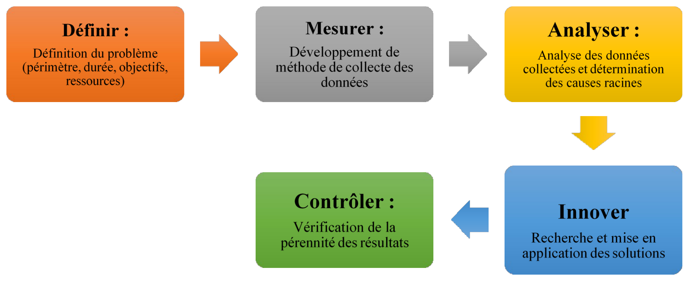

La démarche DMAIC se compose d’un ensemble d’outils successifs et agit comme un filtre permettant de passer d’une problématique complexe présentant des variables non maîtrisées, à une amélioration et une maîtrise du processus.

- D pour Définir : Il s’agit de la première étape de la démarche qui clarifie les enjeux du projet, identifie les attentes du client, fixe les objectifs à atteindre. Cette phase permet de comprendre le problème et ses impacts et d’identifier les opportunités.

- M pour Mesurer : Cette étape permet de collecter des données sur les paramètres mesurables du processus et d’étudier le système de mesure. A ce stade, les contours du problème sont délimités et des méthodes de collecte de données appropriées sont développées.

- A pour Analyser : Les données obtenues à la phase précédente sont analysées afin de calculer les écarts de performance. Les origines de la variabilité du processus sont étudiées dans le but d’en déterminer les causes racines. Le groupe projet propose alors des solutions d’amélioration répondant aux objectifs.

À la suite de ces trois étapes, le problème est entièrement caractérisé (stabilité du processus, étendue des impacts, variations potentielles etc…).

- I pour Innover : Les solutions aux dysfonctionnements sont générées, validées et mises en application par l’équipe projet. Un plan d’action détaillant la mise en œuvre des solutions retenues est élaboré afin de piloter les solutions implémentées et de mitiger les risques induits.

- C pour Contrôler : Cette dernière étape consiste à contrôler le processus pour s’assurer que le problème est résolu et que la solution mise en place atteint le niveau de qualité souhaité. Le processus est standardisé et un bilan est réalisé afin de vérifier la solution pratique, de chiffrer les gains obtenus et de garantir la pérennité des résultats.

### Les outils d’analyses des problèmes
- **L’outil « QQOQCP » :**

Le QQOQCP est une méthode pour éclaircir une situation donnée, décrire un processus et planifier des actions. Elle pose 6 questions relatives à cette situation afin de collecter le maximum de données : Qui, Quoi, Où, Quand, Comment, Pourquoi.

Cette méthode est souvent utilisée pour structurer une procédure ou pour construire efficacement une action corrective. Il se base sur un questionnement ouvert afin de collecter les données. L’enchaînement des questions :

- Qui ? Les acteurs : Qui est concerné, impliqué ? Qui est l’opérateur ?

- Quoi ? Le sujet : De quoi s’agit-il ? Vers quoi ça mène ?

- Où ? La localisation : Où se déroule l’action ?

- Quand ? Le temps : Quelle est la date, l’heure ? Quelle est la période ?

- Comment ? La démarche : Comment ça se produit ? Comment on s’organise ?

- Pourquoi ? Les causes : Comment l’expliquer ? Quelle en est l’origine ? Les objectifs : Dans quel but ? Quelle est la finalité ?

Elle peut être utilisée dans le cadre d’un brainstorming afin de construire rapidement un diagramme d’affinité.

- **Diagramme d’ISHIKAWA :**

Le diagramme de causes et effets, ou diagramme d'Ishikawa, ou diagramme en arêtes de poisson ou encore 5M, est un outil développé par Kaoru Ishikawa en 1962 et utilisé en gestion de la qualité. Ce diagramme représente de façon graphique les causes aboutissant à un effet. Il peut être utilisé dans le cadre de recherche de cause d'un problème ou d'identification et gestion des risques lors de la mise en place d'un projet. Ce diagramme se structure habituellement autour du concept des 5 M. Kaoru Ishikawa recommande de regarder en effet l'événement sous cinq aspects différents :

● ***Matière :*** les matières et matériaux utilisés et entrant en jeu, et plus généralement les entrées du processus.

● ***Matériel :*** l'équipement, les machines, le matériel informatique, les logiciels et les technologies.

● ***Méthode :*** le mode opératoire, la logique du processus et la recherche et développement.

● ***Main-d'œuvre :*** les interventions humaines.

● ***Milieu :*** l'environnement, le positionnement, le contexte.

### Maintenance Préventive
La maintenance préventive est l’ensemble des activités réalisées selon des critères prédéterminés, dans l’intention de réduire la probabilité de défaillance d’un bien ou la dégradation d’un service rendu.

La maintenance préventive consiste à effectuer des tâches de maintenance de routine sur les équipements concernés à un rythme régulier. Elle vise à optimiser les temps d'arrêt et à limiter les réparations non planifiées. La réalisation de la maintenance préventive présente les avantages suivants :

Amélioration de la fiabilité des machines : Une maintenance régulière accroît les chances de déceler et de régler les problèmes en amont, de manière qu'ils ne se manifestent pas par des pannes mécaniques.

Réduction des temps d'arrêt : L'exécution de l'entretien de routine à des moments déterminés contribue à la diminution de l'entretien non planifié et renforce l'efficacité de la production.

Meilleure conformité : La maintenance programmée offre aux fabricants la possibilité de mieux satisfaire aux exigences réglementaires sans avoir à payer de pénalités injustifiées pour non-respect de la réglementation.

### Maintenance Autonome
La maintenance autonome désigne une démarche de maintenance des équipements impliquant la prise en charge des tâches de maintenance de base par les opérateurs de machines. Cela a pour effet d’encourager les opérateurs à bien connaitre leurs machines et de libérer les techniciens de maintenance spécialisés pour se consacrer à des tâches de maintenance à caractère plus complexe. Appliquée, la maintenance autonome procure un ensemble d'avantages :

Une réduction des temps d'arrêt de l’équipement : L'exécution d'activités de maintenance de routine permet de détecter les pannes éventuelles et de limiter la nécessité d'une maintenance non planifiée.

Une meilleure fiabilité des machines : Les opérateurs formés à l'entretien de leurs équipements ont de meilleures chances de repérer les problèmes avant que ceux-ci ne provoquent une défaillance de la machine.

Prolongation de la durée de vie des machines : Tout équipement bien entretenu résiste mieux à l'usure et implique donc moins de réparations ou de changements de matériel.

Une plus grande implication de l’opérateur : Lorsque les opérateurs prennent une part active à la préservation de leurs machines, ceux-ci se reconnaissent et se responsabilisent.

Sécurité renforcée : Grâce à l'inspection et à l'entretien réguliers de l'équipement, le dépistage des risques avant qu'ils ne se transforment en accidents est plus facile à mettre en œuvre.

Rentabilité : Le fait de réduire la maintenance non planifiée constitue une économie importante pour les fabricants à long terme

### Contrôle qualité
Le contrôle est une opération destinée à déterminer, avec des moyens appropriés, si le produit contrôlé est conforme ou non à ses spécifications ou exigences préétablies et incluant une décision d'acceptation, de rejet ou de retouche.

Le contrôle est un acte technique permettant de déterminer la conformité d'un produit. Pour effectuer un contrôle sur un produit, il faut au préalable en déterminer les caractéristiques et choisir les tolérances à l'intérieur desquelles le produit est conforme. Il faut que ces tolérances soient connues par la personne qui effectuera le contrôle.

Les anciennes versions de la norme ISO 9001 (version 1987 et 1994) prévoyaient trois types de contrôle : à la réception, en cours de réalisation (fabrication) et en finals.

Le contrôle à réception concerne les matières premières au sens large qui seront utilisées dans la fabrication. Une bonne part de ces contrôles peut être effectuée par l’usine. Celui-ci étant spécialisé dans la production de cette matière, il est généralement plus qualifié et mieux équipé pour effectuer les contrôles et essais sur le produit. La réception étant souvent alors accompagnée d'un document (certificat de conformité, données sur les produits, …).

Le contrôle en fabrication répond à plusieurs objectifs : éliminer les non-conformités, détecter les dérives et ainsi participer au pilotage de la fabrication. L'élimination des non-conformités en cours de fabrication répond à un impératif économique : plus le produit non conforme est rebuté tôt moins la valeur ajoutée est importante. Mais également certaines caractéristiques ne sont plus accessibles lorsque le produit est fini. Il est donc nécessaire d'effectuer le contrôle avant que la caractéristique ne soit masquée. Mais le contrôle en fabrication est aussi un instrument de pilotage. Il permet de détecter les dérives et ainsi d'apporter les actions correctives. Si cette détection est bien menée, la correction peut être menée avant que la non-conformité n'apparaisse.

## La démarche de traitement de la problématique
La démarche DMAIC dispose de plusieurs outils, qui permettent de passer d’une problématique complexe à une amélioration et une maîtrise du processus. Cette démarche est adaptée au sujet qui vise à améliorer la précision des longueurs de câble coupées, car la longueur est un paramètre de précision que l’on peut mesurer facilement. Ceci permettra d’identifier les causes des fausses longueurs de câble afin de mettre en place les actions amélioratives pour y faire face. Le but principal de l’étude est de fiabiliser le processus de coupe, et de mettre en place un nouveau mode opératoire de coupe, et mettre en place un plan de maintenance préventif, afin d’améliorer le processus de coupe en interne et satisfaire le client en externe.

### Définir
#### Présentation de la problématique
Le service client a connu beaucoup de réclamations clients sur les longueurs de câble. Il s’agit souvent de grands clients institutionnels qui réclament des longueurs courtes de câbles. Depuis ce temps-là, la direction du site a exprimé un besoin d’amélioration de la performance logistique et de la qualité.

Ce projet a été concentré sur le processus de coupe de câble tiers qui est considéré comme le produit qui a le plus d’importance au niveau du site logistique de l’entreprise vu sa grande contribution dans le chiffre d’affaires du site.

Ce processus logistique est caractérisé par le non-respect des longueurs demandées par le client ce qui affecte négativement la notion de la qualité, un écart au niveau du stock, et une absence d’un contrôle des longueurs de câble en provenance de l’usine.

#### Outils QQOQCP
Pour mieux clarifier la problématique du projet, il s’avère très utile et important de réaliser un QQOQCP (Qui, Quoi, Où, Quand, Comment, Pourquoi). En effet, cet outil permet de mieux cadrer le sujet de la problématique.

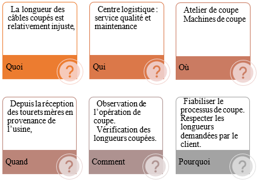

Figure 2 : QQOQCP de la problématique

#### Processus de logistique aval au site
Les opérations de distribution de câbles sont gérées par le Centre Logistique et de Services (CLS) de l’entreprise en Île-de-France.

**Réception des tourets de câbles :** Les câbles et autres produits sont livrés par divers fournisseurs, qu'il s'agisse des usines de production de l’entreprise ou de fournisseurs locaux.

La vérification de la qualité et de la conformité des produits est effectuée lors de la réception, en vérifiant **uniquement la quantité des tourets** ainsi que l’aspect physique du câble.

**Mise en stock des tourets :** Après déchargement de marchandises, le chariot élévateur déplace les tourets de câbles vers une zone d’attente, le zonage et l’adressage des lots se font suivant les zones :

- Stock appartenant aux clients

- Emplacements du parc extérieur

- Emplacements du rack extérieur

La gestion du stock implique l'utilisation d'un système de gestion des stocks (SAP) afin de surveiller en temps réel les quantités disponibles, les emplacements des articles et les mouvements internes.

**Ordonnancement des coupes :** Le système informatique central reçoit les commandes des clients et les organise en fonction de la disponibilité des produits et des délais de livraison.

Le responsable d’ordonnancement lance le programme de coupe à faire à partir du carnet de commandes et imprime les feuilles de coupe. Ces feuilles de coupe seront récupérées par le chef d’équipe de l’atelier afin qu’il puisse chercher les tourets destinés à la coupe dans le parc extérieur.

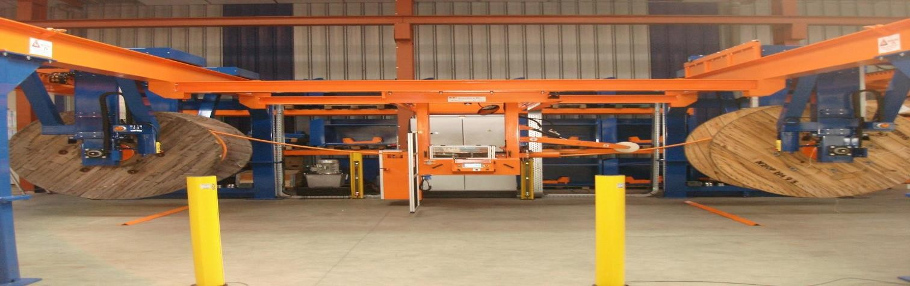

**Processus de la prestation de coupe :**

Figure : Photo d'une machine de coupe M9

Ligne de découpe de câbles dispose de :

- 1 dérouleur / 1 enrouleur.

- 1 banc de mesure, coupe et trancanage

**Préparation des tourets mères côté dérouleur :** Le chef d’équipe a pour mission de préparer les tourets mères figurant dans les feuilles d’ordonnancement dans une ligne côté dérouleur, ainsi il effectue l’évacuation des tourets vides.

Ensuite l’opérateur de la machine a pour manipulations de :

- Positionner les bras côté dérouleur en butée côté armoire de la machine à l’aide de la boîte à boutons située sur le bras droit côté dérouleur.

- Présenter le touret plein, prêt à être déroulé côté armoire.

- Ajuster la hauteur des pointes au niveau de l’axe du touret grâce à la boîte à boutons située sur le bras droit côté dérouleur.

- Mettre le touret entre les pointes en utilisant la boîte à boutons de gauche

- Monter le touret jusqu’en haut.

- Ajuster sa position à droite ou à gauche selon le mode de fonctionnement désiré.

**Préparation tourets filles côté enrouleur :**

Le chef d’équipe a pour mission de préparer les tourets filles nécessaires pour les coupes demandées dans une ligne côté enrouleur, ainsi il effectue l’évacuation des tourets pleins.

Ensuite l’opérateur de la machine a pour manipulations de :

- Positionner les bras côté enrouleur en butée côté armoire de la machine à l’aide de la boîte à boutons située sur le bras gauche côté enrouleur.

- Présenter le touret vide, prêt à être enroulé côté armoire.

- Ajuster la hauteur des pointes au niveau de l’axe du touret grâce à la boîte à boutons située sur le bras gauche côté dérouleur.

- Mettre le touret entre les pointes en utilisant la boîte à boutons de gauche, puis celle de droite.

- Monter le touret tout jusqu’en haut.

- Ajuster sa position à droite ou à gauche selon le mode de fonctionnement désiré

**Chargement du touret mère sur le dérouleur :**

Avant de commencer le chargement, l’opérateur vérifie la feuille de coupe si elle correspond à l’étiquette du touret. Après chargement du touret sur le dérouleur, l’opérateur a ensuite pour manipulations de :

- Ouvrir la chenille avec l'écran tactile, ou le bouton sur le côté, à gauche du banc de mesure.

- Introduire le câble entre les rouleaux de guidage du trancanage.

- Positionner le câble entre les rouleaux de la chenille.

- Serrer la chenille, régler la pression de serrage en fonction du câble à enrouler.

**Chargement du touret fille sur l’enrouleur :**

Au début, l’opérateur vérifie le diamètre du touret nécessaire, nettoie et prépare le nombre de tourets suffisant côté enrouleur. Ensuite le touret est monté sur l’enrouleur, après l’opérateur fixe le bout du câble sortant de la machine sur le touret à l’aide d’une ficelle.

**Manipulations informatiques :**

- Scanner l’étiquette du touret mère.

- Renseigner les numéros de tourets fille sur SAP.

- Renseigner les valeurs du marquage métrique début et fin.

- Confirmation des coupes et impression des étiquettes.

**Trancanage :**

L’opérateur commence par faire une spire pour bien fixer le câble autour du touret et ensuite règle l’automate. Après il entre la longueur finale désirée, les longueurs intermédiaires ainsi que le mode de trancanage (électronique/manuel).

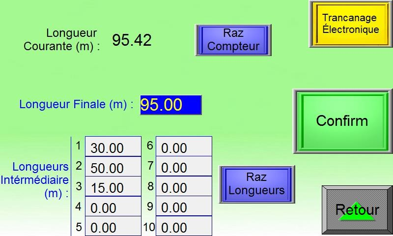

Figure : Ecran de programmation

Les informations suivantes s’affichent :

- Vitesse en mètres par minute.

- Longueur enroulée.

- Diamètre en mm

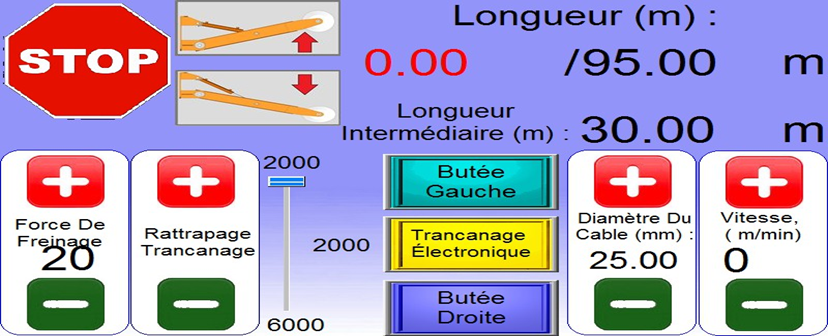

Figure : Ecran de marche

Grâce aux boutons correspondant à chaque fonction, l’opérateur peut :

- Augmenter ou diminuer la vitesse. Une rampe d’accélération est intégrée dans l’automatisme.

- Augmenter ou diminuer le diamètre. Le diamètre peut aussi changer en appuyant à l’endroit où il est affiché.

- Augmenter ou diminuer le freinage.

- Ralentir ou accélérer ponctuellement le trancanage.

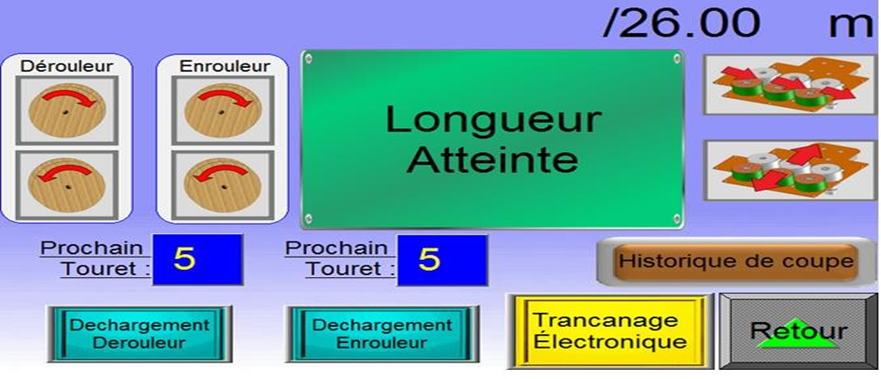

Figure : Ecran fin de cycle

Quelques mètres avant la fin, l’opérateur diminue la vitesse légèrement pour s'arrêter d'une façon précise à la longueur sélectionnée, ensuite l’opérateur permet de :

- Couper le câble à l'aide du coupe câble hydraulique.

- Sélectionner le numéro du prochain touret puis appuyer sur déchargement.

- Enrouler le câble de chaque côté grâce aux boutons des boîtes à boutons correspondantes.

- Attacher la queue de câble sur le touret fini.

**Emballage et mise en stock**

Le touret est descendu de l’enrouleur, il est ensuite emballé et basculé vers la zone de stockage avec une étiquette sur le côté de la joue. Le touret sera mis directement dans le parc s’il n’est pas destiné à la livraison. Si le touret est destiné à la livraison, il sera mis dans la zone d’expédition dans l’atelier.

**Préparation des commandes et livraison :**

- Le gestionnaire transport vérifie le planning de livraison et communique les commandes à préparer pour chaque client aux opérateurs de préparations.

- La marchandise à destination du client CdA et ses sous-traitants sont préparées sur la zone de préparation dédiée au lot.

- La livraison des clients dans la région parisienne est dont le poids de la marchandise ne dépasse pas 7 tonnes est gérée par la flotte de trois camions appartenant à l’entreprise.

- Le reste des livraisons ne subit pas une préparation des lots, les camions sont chargés directement par les chariots élévateurs.

- La fréquence de livraison est de maximum 3 lots par semaine. Un lot correspond à un camion chargé complètement de marchandises (palettes et/ou tourets).

- Les marchandises chargées sur les camions subissent un dernier contrôle qualitatif et quantitatif avant l’expédition.

**Logigramme du processus de la logistique aval :**

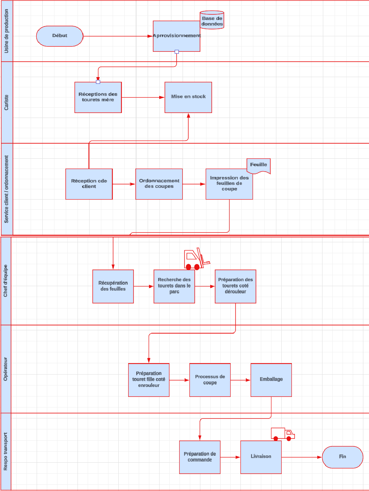

#### Périmètre du projet
L’étude s’encadre entre le stock des tourets et la zone d’expédition de sortie de livraison et passe par : (Zone encadrée en rouge)

- La zone de réapprovisionnement des machines.

- La machine de coupe

- Zone tourets vides

- Stock des expéditions en attente

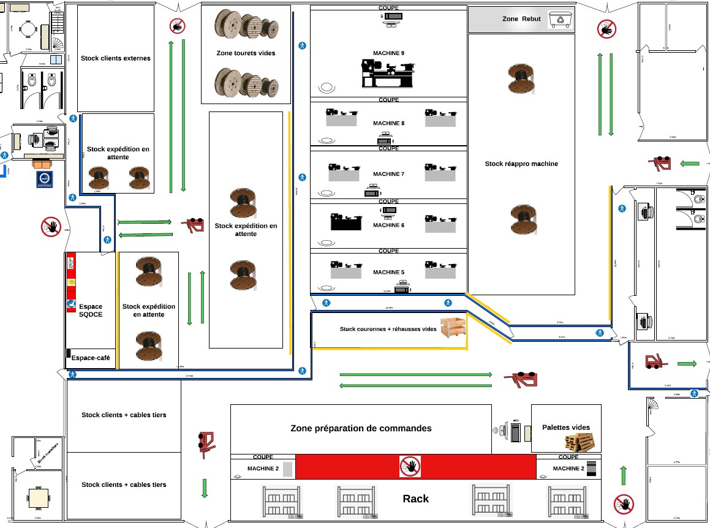

Figure : Plan de l'atelier réalisé par VISIO

#### États des lieux et objectifs
L’état des lieux que j’ai effectué a montré des pistes d’améliorations sur plusieurs points au niveau du périmètre de l’étude :

**Le marquage métrique :**

- En utilisant une imprimante industrielle, le marquage par jet d'encre consiste à propulser des microgouttelettes d'encre sur la surface du produit. Le marquage métrique implique d'imprégner directement le câble ou le produit concerné de repères métriques, comme **des graduations tous les mètres**.

- Ce que j’ai remarqué à propos du marquage métrique, c’est qu’il n’est pas juste pour certaines références de câbles. Autrement dit, la longueur entre deux marquages consécutifs varie entre 99 cm et 100cm.

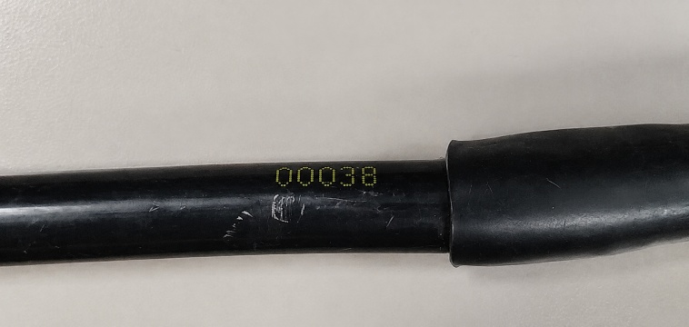

Figure : Marquage métrique sur le câble

**Inventaire des tourets de câbles approvisionnés :**

- L’inventaire des tourets dans le stock est effectué d’une façon semestrielle.

- Cette procédure s’effectue par le personnel du site en se basant sur l’observation et la prise de note à la main.

- Mon constat à propos de cette procédure classique c’est que des écarts de stock significatifs sont détectés au niveau du stock, ainsi plusieurs longueurs déclarées sur les étiquettes de stock sont souvent fausses.

**La procédure de coupe :**

La vitesse de déroulage, le diamètre du câble et les consignes de découpe sont considérés comme l’un des éléments importants pour assurer une meilleure précision de coupe.

J’ai souvent remarqué que l’opérateur de la machine ne respecte pas correctement ces éléments, en ce qui concerne la vitesse d’enroulement qui correspond à chaque diamètre de câble, ainsi que d’autres manipulations du câble.

**Maintenance des machines :**

La maintenance des machines est gérée par le fournisseur des machines de coupe. Le contrat établit avec ce fournisseur permet d’effectuer la maintenance corrective et générale des machines d’une façon trimestrielle.

D’après ce que j’ai remarqué, il n’existe pas de plan de maintenance préventif pour les métreuses des machines, ainsi que les variateurs de vitesse.

Ainsi, il y a eu deux pannes sur deux machines différentes ce qui a ralenti la cadence de production et a causé des retards de livraison.

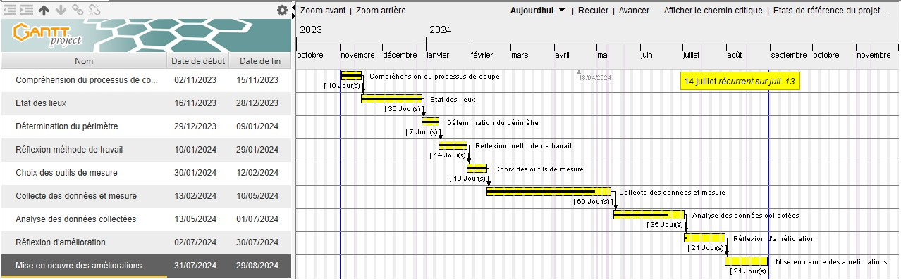

#### Diagramme de Gantt
Figure : Diagramme de Gantt de l'étude

**Objectifs à atteindre :**

Cette étude a pour but d’éliminer l’écart entre le métrage métrique et le métrage donnée par la machine. Ceci permettra d’améliorer la précision des longueurs de câbles coupées afin de respecter les longueurs demandées par le client.

### Mesurer
#### Brainstorming
Après une série de visualisation du processus de coupe, des discussions avec les opérateurs de machines et les chefs de l’atelier, une réunion de brainstorming a été programmée avec le directeur du site pour proposer les idées de traitement de la problématique.

Le brainstorming a porté sur la mise en accord sur la méthodologie et le mode de travail. Après plusieurs réunions, on s’est mis d’accord sur les méthodes de vérification des longueurs de câbles ainsi que les références de câbles prioritaires.

#### Méthodes de vérification des longueurs de câble
Tout d’abord, je me suis intéressé à la collecte de données concernant l’opération de coupe. Ensuite j’ai proposé trois méthodes pour vérifier la longueur de câble :

#### Méthode du mesureur
Le mesureur de longueur de câbles est un instrument qui mesure et indique la longueur des câbles sur une plage de mesure très étendue allant de 0,1 m à 30 km. Sachant que le mesureur de longueur de câbles détermine la longueur au moyen de la résistance du câble, il calcule aussi la résistance entre 0,1 mΩ et 1999,9 Ω. Il intègre la mesure des câbles en cuivre et en aluminium. Le principe de mesure nécessite de connecter les pinces crocodiles aux deux extrémités du câble.

Caractéristiques :

- Unités : m / km / ft

- 8 positions de mémoire personnalisables pour câbles individuels

- Pour câbles en cuivre et en aluminium

- Types de câble standard sélectionnables : 0,15 ... 240 mm²

- Arrêt automatique après 15 minutes d’inactivité

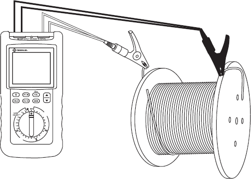

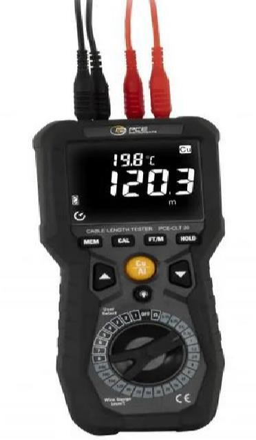

*Figure 11: Instrument de mesure et mode d’emploi*

Le processus de cette méthode :

- Dénuer les deux bouts de câbles à l’aide d’un coupe-câble jusqu’à l’apparition de la partie en cuivre ou aluminium et les exposer à la température ambiante.

- Nettoyer et sécher les deux bouts du câble.

- Allumer l’instrument, brancher les deux câbles avec l’appareil et calibrer l’appareil suivant son mode d’emploi.

- Choisir le type de câble : cuivre ou aluminium

- Choisir la section du câble.

- Brancher les deux pinces à crocodiles avec les deux bouts de câbles.

- Attendre un instant avant l’affichage de la longueur du câble en mètres sur l’écran.

#### Méthode du poids
Le principe de cette méthode est défini comme suivant :

- Peser le touret plein avec le câble et noter le poids total.

- Peser le touret vide sans câble et noter le poids.

- Prendre un échantillon de câble dont la longueur est connue et déterminer son poids sur la balance.

- A partir des données sur le poids et la longueur de l’échantillon, on peut déterminer la longueur totale du câble en faisant la règle de trois.

***La formule de calcul est la suivante : L = 5 \* (K’ – K) / X***

L : longueur totale du câble (m) K : poids du touret vide (kg)

K’ : poids du touret rempli (kg) X : poids de 5 m de câble (kg)

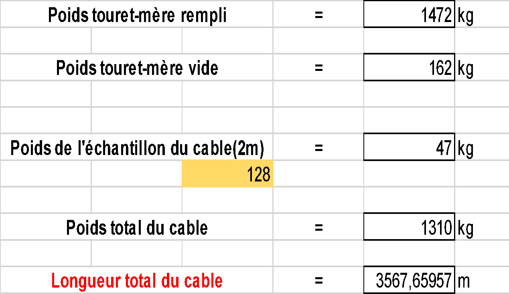

Figure : Formule de calcul de la méthode de poids

Pour avoir les poids des tourets vides j’ai été amené à peser sur la balance les tourets vides de différentes tailles allant de 60cm jusqu’à 210cm.

Tableau : Poids des tourets vides pesés

| Type touret | Diam des joues(mm) | Surface (m²) | Poids pesé(kg) |
|---|---|---|---|
| 090 | 900 | 1,0296 | 33 |
| 105 | 1050 | 1,2012 | 39 |
| 115 | 1150 | 1,6606 | 52 |
| 120 | 1200 | 1,7808 | 72 |
| 130 | 1300 | 1,8772 | 6 |
| 140 | 1400 | 2,0384 | 92 |
| 153 | 1530 | 2,25828 | 132 |
| 165 | 1650 | 3,036 | 212 |
| 183 | 1830 | 4,1724 | 248 |
| 190 | 1900 | 4,2256 | 252 |
| 210 | 2100 | 4,788 | 312 |

#### Méthode de circonférence
Le principe de cette méthode repose sur le calcul de la longueur totale du câble en fonction de la circonférence ajustée au nombre de tours du câble sur le touret.

L'estimation de la longueur totale du câble sur le touret est donnée par la formule ci-dessous en fonction du nombre de couches et de tranches et des diamètres du touret. Cela implique que le câble est régulièrement enroulé sans perdre trop de place entre les tours. En réalité, la mesure effective peut différer selon la manière dont le câble est enroulé et d'autres éléments.

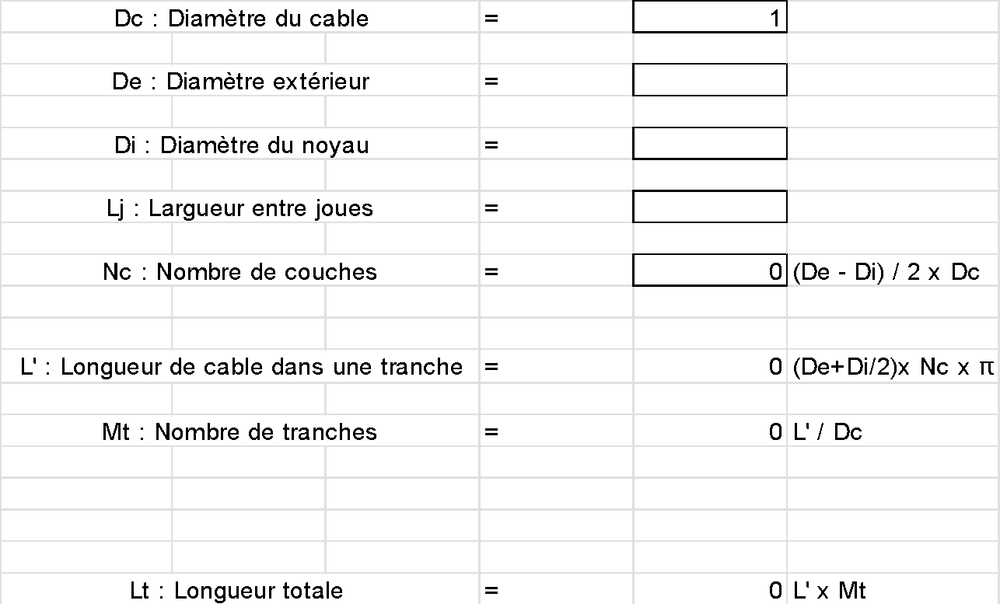

Figure : Formule de calcul méthode de dimensions

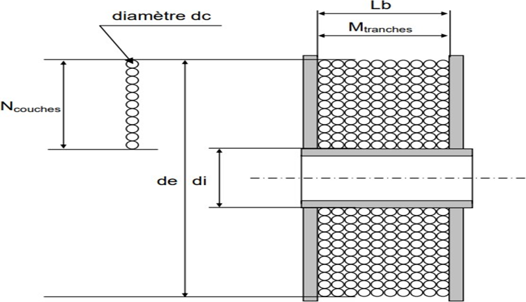

Figure : Dimensions du touret plein

Pour appliquer cette méthode, j’ai été amené à collecter les données concernant les différentes dimensions des tourets de taille allant de 60cm jusqu’à 210cm de hauteur auprès du fournisseur des tourets vides.

| CODE PRODUIT FOURNISSEUR | Diamètre joues | Ep. joues | Diamètre tambour | Largeur utile | Poids | Diam trou de la goupille | Diam trou axe |
|---|---|---|---|---|---|---|---|
| E60C1 | 600 | 25 | 300 | 522 | 15 | 83 | 32 |
| E75N1 | 750 | 28 | 350 | 516 | 22 | 83 | 32 |
| E90S1 | 900 | 32 | 500 | 508 | 35 | 83 | 32 |
| E105A# | 1 050 | 36 | 500 | 500 | 47 | 83 | 35 |
| E115# | 1 150 | 36 | 600 | 650 | 60 | 83 | 32 |
| E120# | 1 200 | 36 | 600 | 670 | 69 | 83 | 40 |
| E130# | 1 300 | 36 | 700 | 650 | 80 | 83 | 40 |
| E140A# | 1 400 | 44 | 600 | 640 | 100 | 83 | 40 |
| E153J# | 1 530 | 44 | 800 | 650 | 122 | 83 | 40 |
| E165A# | 1 650 | 50 | 900 | 820 | 170 | 83 | 40 |
| E190# | 1 900 | 56 | 1 000 | 1 000 | 256 | 83 | 50 |
| E210K# | 2 100 | 64 | 1 100 | 1 000 | 350 | 83 | 50 |

Tableau : Les dimensions des tourets fournies par le fournisseur de tourets

#### Application des méthodes de mesures
Dans le but de gagner en termes de temps et de disponibilité des machines, j’ai décidé d’appliquer les trois méthodes successivement sur plusieurs échantillons de câble.

D’abord j’étais amené à identifier les tourets de câble des références prioritaires existantes dans le programme de coupe en préférence, concernant tout type de diamètre :

- Grand diamètre : \> 30 mm

- Moyen diamètre : entre 30 et 20mm

- Petit diamètre : \< 20mm

Ensuite, en moyenne chaque semaine, je prépare la liste des tourets échantillons à tester ainsi que la fiche de coupe qui sera transmise à l’opérateur de machine.

Cette fiche de coupe contient toutes les informations sur le câble à renseigner par l’opérateur. Avant de mettre le touret sur machine, il est d’abord pesé sur la balance pour noter son poids dans la fiche.

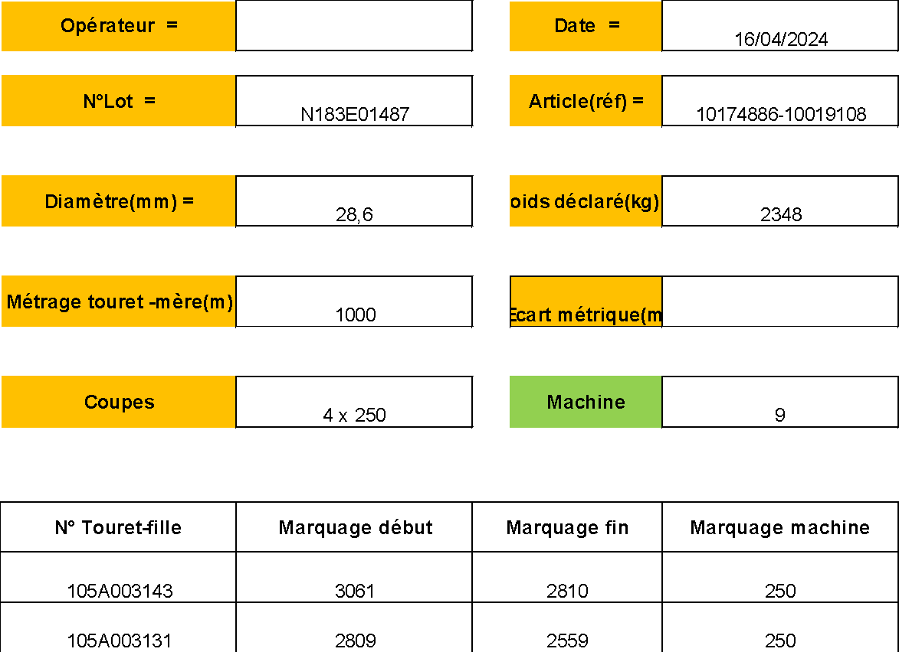

Figure : Exemple de fiche de coupe

Dans cette fiche de coupe, l'opérateur note la longueur donnée par la métreuse de machine après le déroulage, ainsi que les marquages métriques du début et fin qui apparaissent sur les deux bouts du câble.

Le marquage métrique est vérifié à l’aide d’un mètre, en mesurant la longueur entre deux marquages consécutifs.

A la fin du déroulage, l’opérateur note la longueur de câble en surplus ou en manquant.

Après le déroulage du câble sur un autre touret, le touret-mère sera pesé pour avoir le poids du touret vide.

D’un autre côté, l’opérateur est appelé à dénuer les deux bouts du câble pour procéder à la mesure avec l’appareil.

À travers cette collecte de données, j’ai réalisé un tableau contenant les différentes mesures réalisées.

| N° lot | Article | Stock dispo(m) | Poids(kg) | Diamètre | Mq métrique | Mq machine |
|---|---|---|---|---|---|---|
| N165A02930 | 10242675- 10055653 | 65 | 300.154 | 47,1 | 65 | 65,33 |
| N183E01436 | 10270835- 10019108 | 1000 | 2725,417 | 31,9 | 1000 | 998,89 |
| N183E01487 | 10270835 | 1000 | 2725,417 | 31,9 | 1005 | 1002,3 |
| N183E01484 | 10270835- 10019108 | 1000 | 2725,417 | 31,9 | 1000 | 994,76 |
| N165A03554 | 10270826 | 1000 | 2692,717 | 28,8 | 999 | 997,74 |
| N165A03650 | 10174886- 10019108 | 1000 | 2348 | 28,6 | 1036 | 1035 |
| N165A03569 | 10174886- 10019108 | 1000 | 2348 | 28,6 | 1045 | 1040 |
| N165A02797 | 10224666- 10019108 | 3500 | 1018,5 | 13,3 | 3528 | 3519 |
| N165A03210 | 10224666- 10019108 | 3500 | 1018,5 | 13,3 | 3564 | 3561,4 |
| N210P00774 | 10224666- 10019108 | 3500 | 1018,5 | 13,3 | 3445 | 3436 |
| N153J02659 | 10141944- 10019108 | 5000 | 1000 | 11,2 | 5080 | 5050 |
| N153J02669 |  | 4500 | 950 | 11,2 | 4467 | 4410 |

Tableau : Echantillon des mesures effectuées sur les tourets de câble

| N° lot | Article | Stock dispo(m) | Diamètre | Méth.poids | Méth.dim ension | Méth.Ins trument |
|---|---|---|---|---|---|---|
| N165A029 30 | 10242675- 10055653 | 65 | 47,1 | 61.65 | 62.23 | \*\*\* |
| N183E014 36 | 10270835- 10019108 | 1000 | 31,9 | 918,67 | 1063,36 | 1007,22 |
| N183E014 87 | 10270835 | 1000 | 31,9 | 919 | 532 | 1007,73 |
| N183E014 84 | 10270835- 10019108 | 1000 | 31,9 | 908,67 | 1012,73 | 1007,41 |
| N165A035 54 | 10270826 | 1000 | 28,8 | 1021,1 | 850,35 | 1005,25 |
| N165A036 50 | 10174886- 10019108 | 1000 | 28,6 | 1035,5 | 960,16 | 1004,84 |
| N165A035 69 | 10174886- 10019108 | 1000 | 28,6 | 1172,5 | 1152,74 | 1005,45 |
| N165A027 97 | 10224666- 10019108 | 3500 | 13,3 | 3405,56 | 2048 | 3504,16 |
| N165A032 10 | 10224666- 10019108 | 3500 | 13,3 | 3567,66 | 2799 | 3504,49 |
| N210P0077 4 | 10224666- 10019108 | 3500 | 13,3 | 3226 | 2048 | 3504,36 |
| N153J0265 9 | 10141944- 10019108 | 5000 | 11,2 | 3567,66 | 4868,52 | 5003,44 |
| N153J0266 9 | 10141772- 10019108 | 4500 | 11,2 | 4263,45 | 4321,57 | 4502,64 |

Tableau : Echantillon des mesures effectuées avec les trois méthodes

| Article | Stock Disponible (m) | Diamètre | Marquage métrique | Marquage machine | Ecart mac/mar | Ecart marquage | Ecart mq total | Longueur théorique |
|---|---|---|---|---|---|---|---|---|
| 10174886- 10019108 | 1000 | 28,6 | 1045 | 1040 | 5 | 0,009 | 9,405 | 1035,595 |
| 10174886- 10019108 | 1000 | 28,6 | 1036 | 1035 | 1 | 0,007 | 7,252 | 1028,748 |
|  | 4500 | 11,2 | 4467 | 4410 | 57 | 0,01 | 44,67 | 4422,33 |
| 10224666- 10019108 | 3500 | 13,3 | 3445 | 3436 | 9 | 0,005 | 17,225 | 3427,775 |
| 10224666- 10019108 | 3500 | 13,3 | 3564 | 3561,4 | 2,6 | 0,005 | 17,82 | 3546,18 |
| 10141944- 10019108 | 5000 | 11,2 | 5080 | 5050 | 30 | 0,007 | 35,56 | 5044,44 |
| 10224666- 10019108 | 3500 | 13,3 | 3528 | 3519 | 9 | 0,006 | 21,168 | 3506,832 |
| 10270835- 10019108 | 1000 | 31,9 | 1000 | 994,76 | 5,24 | 0,005 | 5 | 995 |
| 10270835 | 1000 | 31,9 | 1005 | 1002,3 | 2,7 | 0,007 | 7,035 | 997,965 |
| 10270826 | 1000 | 28,8 | 999 | 997,74 | 1,26 | 0,007 | 6,993 | 992,007 |
| 10242675- 10055653 | 65 | 47,1 | 65 | 65,33 | 0,33 | 0,002 | 0,13 | 64,87 |
| 10270835- 10019108 | 1000 | 31,9 | 1000 | 998,89 | 1,11 | 0,005 | 5 | 995 |

En exploitant les données sur le poids ainsi que les dimensions et l’appareil de mesure, j’ai calculé les longueurs de câbles à l’aide des trois méthodes pour vérifier la longueur réelle du câble.

Par la suite, j’ai calculé la tolérance en % de coupe qui correspond à chaque machine de coupe pour chaque type de diamètre.

**Grand diamètre : \> 30mm**

**Tableau 6: Calcul des % de tolérances**

| Machine | Mq machine | Mq début | Mq fin | MQ,métrique | Long,théor | Tolérance |
|---|---|---|---|---|---|---|
| M9 | 245,85 | 5723 | 5478 | 245 | 245 | 0,347% |
| M8 | 246 | 5723 | 5478 | 245 | 245 | 0,408% |
| M7 | 251 | 5723 | 5478 | 245 | 245 | 2,449% |
| M6 | 246,74 | 5723 | 5478 | 245 | 245 | 0,71% |
| M5 | 246 | 5723 | 5478 | 245 | 245 | 0,408% |

**Moyen diamètre : entre 20 et 30mm**

*Tableau 7: Calcul % de tolérance moyen diamètre*

| Machine | Mq machine | Mq début | Mq fin | MQ,métrique | Long,théor | Tolérance |
|---|---|---|---|---|---|---|
| M9 | 464,5 | 1 | 467 | 466 | 469,728 | 0,319% |
| M8 | 466,6 | 1 | 467 | 466 | 469,728 | 0,128% |
| M7 | 477 | 1 | 467 | 466 | 469,728 | 2,342% |
| M6 | 466,89 | 1 | 467 | 466 | 469,728 | 0,189% |
| M5 | 466,19 | 1 | 467 | 466 | 469,728 | 0,040% |

**Petit diamètre : \< 20mm**

*Tableau 8:Calcul % de tolérance petit diamètre*

| Machine | Mq machine | Mq début | Mq fin | MQ,métrique | Long,théor | Tolérance |
|---|---|---|---|---|---|---|
| M9 | 921 | 3015 | 2090 | 925 | 925 | 0,432% |
| M8 | 933 | 3015 | 2090 | 925 | 925 | 0,865% |
| M7 | 932 | 3015 | 2090 | 925 | 925 | 0,824% |
| M6 | 928 | 3015 | 2090 | 925 | 925 | 0,324% |
| M5 | 933 | 3015 | 2090 | 925 | 925 | 0,865% |

Donc à travers ces trois méthodes, j’ai comparé les différents résultats trouvés pour avoir une idée approximative sur la longueur réelle du câble. Ainsi j’ai vérifié la justesse du marquage métrique sur le câble pour les différentes références et diamètres afin de savoir les références dont le marquage métrique est injuste.

En se basant sur les éléments suivants : marquage métrique sur le câble, la longueur donnée par la métreuse de la machine et les trois méthodes de mesure, j’ai calculé la longueur théorique du câble pour déduire la tolérance de coupe des différentes machines qui correspond à chaque type de diamètre.

### Analyse
Dans cette partie, il s’avère important d’analyser les données fournies par cette étude et les exploiter au profit de l’objectif fixé.

#### Marquage métrique
Concernant le marquage métrique sur le câble, la longueur entre deux marquages successifs doit être égale à un mètre. Cependant, cette longueur est souvent variable selon chaque référence et diamètre de câble.

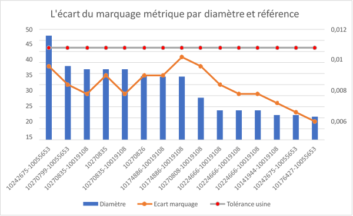

Figure : Diagramme de l'écart métrique en fonction des références

A travers les données du diagramme ci-dessus, on peut déduire les éléments suivants :

- L’écart du marquage métrique est toujours égal ou inférieur à 1cm, ce qui correspond au pourcentage de tolérance (1%) appliquée par l’usine pendant le processus de marquage métrique.

- L’écart métrique est plus élevé pour les câbles dont le diamètre est supérieur ou égale à 20mm.

- Pour des grandes longueurs de câble, l’écart métrique devient très important.

#### Tolérances de machines
Au niveau des machines de coupe, le pourcentage de tolérance varie d’une machine à l’autre selon chaque type de diamètre.

A travers la longueur donnée par la métreuse de chaque machine ainsi que la longueur théorique basée sur le bon marquage métrique, j’ai calculé le pourcentage de tolérance d’erreur qui correspond à chaque machine selon le type de diamètre du câble. (Voir le tableau ci-dessous).

|  | Diamètre | Machine 5 | Machine 6 | Machine 7 | Machine 8 | Machine 9 |
|---|---|---|---|---|---|---|
| Tolérance % | Grand(>30mm) | 0,41 % | 0,71 % | 2,50 % | 0,41 % | 0,35 |
| Tolérance % | Moyen (20-30 mm) | 0,75 % | 0,60 % | 1,55 % | 0,67 % | 0,32 % |
| Tolérance % | Petit(<20mm) | 0,86 % | 0,32 % | 0,82 % | 0,86 % | 0,43 % |

Tableau : Résumé des % de tolérance

A travers l’analyse des données sur les tolérances de machines, on peut conclure que, le diamètre du câble est un facteur important dans le choix de la machine de coupe.

Chaque machine est adaptée à un certain diamètre de câble et change de tolérance d’un diamètre à l’autre, pour ***les machines 5,8 et 9*** : **plus le diamètre diminue plus la tolérance augmente. Pour les machines 6 et 7 : plus le diamètre augmente plus la tolérance augmente**.

La tolérance de coupe doit être prise en compte dans l’affectation des tourets de câble destinée à la coupe en faisant en sorte de **choisir la machine avec le moindre pourcentage de tolérance**.

#### Procédure de coupe
Le processus de coupe est géré selon un mode opératoire qui définit toutes les étapes et les consignes à respecter.

En effet, ces consignes concernent en particulier :

- La vitesse d’enroulement du câble : la vitesse d’enroulement du câble varie en fonction du diamètre du câble :

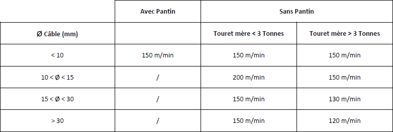

Tableau : Les vitesse d'enroulement admissibles par diamètre

Si la vitesse d’enroulement est supérieure à la vitesse autorisée pour un certain type de diamètre, les rouleaux de guidage tourneront avec une grande vitesse. En effet, la valeur donnée par la métreuse sur la longueur du câble sera fausse (souvent supérieure à la longueur réelle).

Souvent, les opérateurs ne respectent pas les vitesses autorisées pour chaque type de diamètre car ils manquent de formation sur la gestion de vitesse d’enroulement.

- Le diamètre de câble et taille de touret : Pour assurer un bon déroulage du câble, il existe des normes à respecter :

| Tourets admissibles | Dérouleur | Enrouleur |
|---|---|---|
| Ø mini | 750 mm (075) | 750 mm (075) |
| Ø maxi | 2600 mm (IBL) | 2600 mm (IBL) |
| Largeur Maxi | 1600 mm | 1600 mm |
| Largeur Mini | 300 mm | 300 mm |
| Trou central | 82 mm | 82 mm |
| Poids maximum | 6 tonnes | 6 tonnes |

Tableau : Données fournisseurs des diamètres admissibles

#### Inventaire des longueurs de câble dans le stock
Durant la phase de mesure effectuée sur plusieurs échantillons, j’ai constaté des écarts de stock sur quelques références de câbles. Cet écart de stock représente la différence entre la longueur disponible en stock et la longueur réelle du câble.

L’écart de longueur est souvent dû aux éléments suivants :

- Une mauvaise gestion de l’inventaire qui entraîne une estimation incorrecte sur la longueur du câble disponible dans le stock.

- Des erreurs de saisie de la quantité disponible en stock après un déroulage de câble incorrect.

- Le manque de suivi de pertes de câble se produisant lors des coupes en raison de l’usure ou des erreurs de manipulation.

Par conséquence, les écarts de stock peuvent engendrés les problèmes suivants :

- Les incidents de coupe et qui s’agit en particulier des longueurs de câbles manquantes.

- Retards de livraison car les équipes doivent attendre que le câble manquant soit commandé.

- Perte de productivité à cause des interruptions de travail ce qui réduit l’efficacité globale.

#### Résumé de l’analyse en diagramme 5M
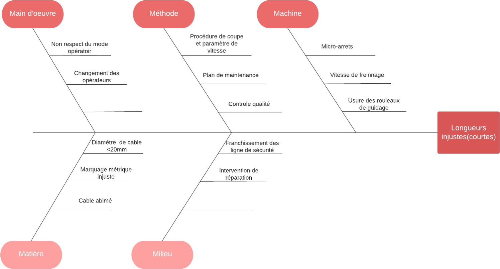

### Innover
Les présentes pistes d’amélioration ont pour but d’améliorer la précision des longueurs de câbles coupés afin d’éviter les problèmes de longueur courtes de câble en amont et satisfaire le client en aval.

Cette amélioration suivra le plan d’action suivant :

#### Contrôle des tourets-mères reçus
Pour éviter les écarts de stock sur les longueurs de câbles, il s’avère très important de contrôler et vérifier la longueur de câble reçu en amont. Il faut vérifier la longueur réelle du câble afin de bien maîtriser le stock disponible et éviter les longueurs courtes. Pour ce faire j’ai proposé d’instaurer les manipulations suivantes :

- Noter le marquage début et fin de la totalité du câble en visualisant le marquage sur les deux bouts du câble.

- Vérifier la justesse du marquage métrique :

Si le marquage métrique est juste, autrement dit la longueur entre deux marquages consécutifs vaut exactement 1 mètre → La longueur réelle est égale à la différence entre marquage début et fin.

Si le marquage métrique est injuste, autrement dit la longueur entre deux marquages consécutifs est inférieure à 1 mètre → La longueur réelle du câble est égale à la différence entre marquage début et fin plus la somme des écarts métriques.

- Peser le touret-mère à l’arrivée en provenance de l’usine.

- Vérifier la longueur totale du câble à l’aide de l’instrument de mesure.

Finalement, on peut déduire la longueur réelle du câble afin de renseigner le bon métrage du câble sur l’étiquette de stock qui sera mise après réception sur le touret.

#### Maintenance des machines
**Maintenance préventive :**

Afin d’éviter l’arrivée d’une panne, tous les deux mois les opérateurs de machines seront sollicités à effectuer les actions suivantes :

▪ Contrôle des courroies du banc de mesure : vérification de l'entraînement et de l'usure et réglage de la tension.

▪ Huiler les différents éléments de rotation ou de glissière.

▪ Nettoyer avec un chiffon les différentes parties en rotation ou en translation.

▪ Nettoyer et huiler les rails de trancanage et les parties mobiles du trancanage.

▪ Nettoyage du sol.

▪ Contrôle visuel de l’état de l’enrouleuse (absence de fuites hydrauliques, pas de pièces mécaniques sur le sol, ...)

Afin de veiller sur le bon fonctionnement de la métreuse de câble, j’ai proposé un plan de maintenance préventive pour les sous-catégorie de la métreuse. Ce plan préventif pourra être réalisé par l’agent de maintenance, ou bien un opérateur de machine, à condition que ce dernier soit formé sur les actions de maintenance du plan ci-dessous. (Plan détaillé en annexe).

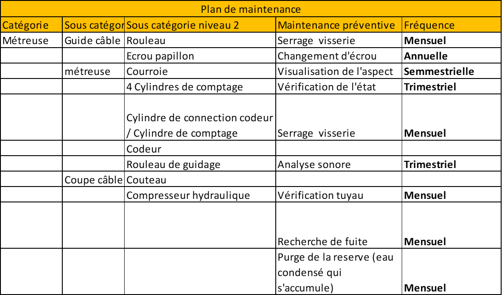

Figure : Extrait du plan de maintenance préventive

**Maintenance par l’agent de maintenance(prestataire) :**

Maintenance par le personnel du prestataire de maintenance :

Tous les 6 mois :

- Contrôle des tuyauteries hydrauliques, resserrage des raccords et vérification des fuites possibles.

- Contrôle des détecteurs de fin de course, vérification de l'état et du bon fonctionnement. Vérifier le bon serrage de tous les boulons.

Tous les ans :

- Contrôle de l'armoire électrique Resserrage des bornes à vis.

- Contrôle des glissières de levage des bras, vérification de l'usure, réglage ou changement des rouleaux.

- Contrôle de l'embrayage, vérification de l'usure et du bon fonctionnement sur la chenille de comptage.

- Graissage complet des organes. Vérification complète.

- Etalonnage

Tous les 2 ans maximum : Lubrification des réducteurs

- Effectuer la vidange

Tous les 5 ans :

- Changement du câble du codeur de comptage.

c\. Etalonnage de la métreuse :

Il est essentiel de calibrer correctement la métreuse de la machine de coupe de câbles électriques afin d'assurer une mesure précise des longueurs de câbles à couper, ce qui réduit les erreurs de coupe et les pertes de matériaux. Voici le processus d'étalonnage de la métreuse :

Préparation à l’étalonnage :

- Avoir un câble de référence (idéalement plusieurs câbles de diamètres différents, avec une longueur mesurée précisément).

- La machine doit être nettoyée, notamment les rouleaux, les capteurs et la métreuse, afin d'éliminer toute saleté ou résidu susceptible d'altérer la précision des mesures.

- Allumer la machine et mettre à zéro la métreuse en utilisant les commandes de la machine.

- Définir les paramètres de la machine tels que le diamètre du câble et la longueur souhaitée.

Exécution de l’étalonnage :

- Réaliser le passage du câble de référence d’une longueur définie (par exemple : 25m) à travers la machine.

- S'assurer que le câble de référence est correctement positionné entre les rouleaux de la métreuse avant de l'insérer dans la machine de coupe.

- Faire circuler régulièrement le câble à travers la machine, à une vitesse de coupe spécifique (vitesse constante conseillée).

- Noter la longueur du câble indiquée par la machine à la fin du déroulage du câble de référence.

Analyse des résultats :

Déterminer la différence entre la longueur mesurée par la machine et la longueur réelle du câble de référence.

Utiliser la formule suivante pour calculer l’erreur de mesure

**Erreur de mesure (%) = 100 x (Longueur mesurée par la machine − Longueur câble référence) / Longueur câble référence**

Lorsque la tolérance de l'erreur dépasse la limite acceptable (par exemple, une tolérance typique pourrait être de ±1%), il faut accéder aux paramètres de la machine via l'interface afin d'ajuster les paramètres de la métreuse.

- Il est possible de modifier les paramètres du compteur de la métreuse, tels que l'ajustement de l'étalonnage ou la calibration des capteurs.

- L'étiquette d'étalonnage doit être appliquée sur la machine, avec la date d'étalonnage, le nom de l'opérateur et la date de l'étalonnage suivant.

En respectant ces étapes, il est possible de garantir un étalonnage adéquat de la métreuse de la machine de coupe de câbles électriques, ce qui assure une précision optimale lors des opérations de coupe. Cela aide à diminuer les ordures, à prévenir les erreurs de coupe et à préserver la qualité des produits finis.

Pour assurer le suivi et l’évaluation de l’opération d’étalonnage, j’ai créé un tableau pour la documentation des résultats incluant les écarts calculés et les ajustements réalisés sur les machines chaque trimestre.

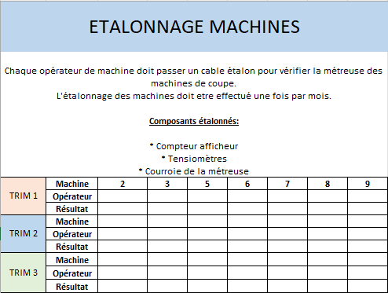

Figure : Programme d'étalonnage des machines

d\. Suivi taux de rebut

Il est crucial de surveiller le taux de rebut du câble coupé afin de surveiller la qualité du processus de coupe, diminuer les pertes de matériaux et améliorer la traçabilité de la quantité de câble disponible en stock.

Le tableau de bord est un élément très important pour le suivi de la performance et l’intervention en cas des fluctuations des indicateurs de performances au niveau d’un poste de travail.

Au niveau de la gestion du stock, il y a une absence d’un suivi des longueurs de câble mis en rebut. Il n’existe aucun chiffre clé permettant de savoir l’état d’évolution des longueurs de câbles.

Tout d’abord, une fiche de suivi a été partagée avec les différents opérateurs de machines afin de pouvoir collecter les données pour la visualisation du taux de rebut pour les différentes références de câble.

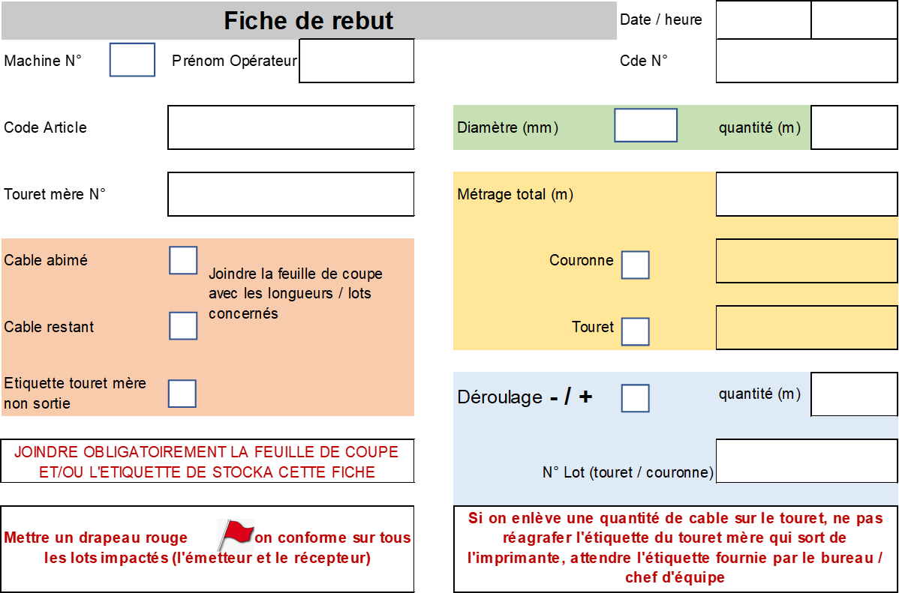

Figure : Fiche de suivi du rebut

J’ai proposé d’organiser les données collectées à travers les fiches de rebut sur un fichier Excel afin de visualiser les différents indicateurs de performance.

Le taux de rebut est calculé comme suit :

***Taux de rebut (%) = (Quantité de câble rebuté / Quantité totale de câble coupé) ×100***

Il est crucial de surveiller attentivement et d'analyser régulièrement les déchets afin d'améliorer l'efficacité et la rentabilité de la production.

Ceci permettra de suivre l’évolution des longueurs de câbles réellement disponibles en stock, ainsi d’avoir une meilleure traçabilité des longueurs de chaque référence de câble.

Les visualisations ci-dessous auront pour but d’évaluer le % du taux de rebut par référence et par machines sur chaque mois.

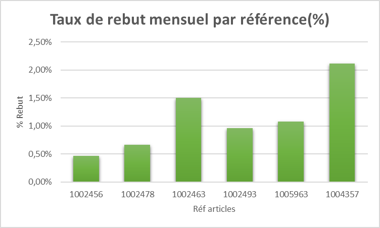

Figure : Visualisation du taux de rebut

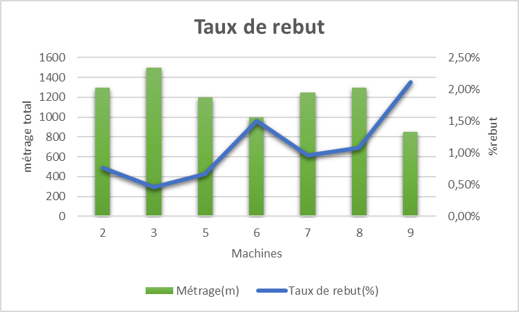

Figure : Visualisation du taux de rebut  par machine

### Contrôler
La phase contrôler reste une phase primordiale pour veiller sur la bonne application des améliorations, la standardisation des actions menées et garantir la pérennité des résultats.

Pour assurer ces points-là, j'ai mis en place un nouveau mode opératoire de gestion du processus de coupe muni de plusieurs consignes à respecter, notamment

#### Mode opératoire
Ce mode opératoire est accompagné d’un ensemble de consignes pour verrouiller toute action aléatoire de la part d’un opérateur.

Ensuite j’ai proposé de réaliser des formations pour les opérateurs de coupe afin de revoir le processus de coupe et veiller au respect des consignes accompagnées. Ce mode opératoire contient plusieurs étapes pour la gestion de coupe :

#### Formation du personnel
Il est essentiel de sensibiliser le personnel à la maintenance autonome et au respect des procédures afin de garantir un bon fonctionnement des machines, diminuer les temps d'arrêt, améliorer la qualité de la coupe et prolonger la durée de vie de l'équipement.

Objectif de la formation :

- Améliorer la compréhension des machines : Mettre en évidence le fonctionnement, les éléments et les procédures de maintenance fondamentales des machines de coupe pour les opérateurs.

- Améliorer le processus de coupe : Accompagner le personnel dans l'apprentissage des démarches indiquées dans le mode opératoire ainsi que les consignes à respecter.

- Encourager l'auto-maintenance : Il est important de permettre aux opérateurs de réaliser des tâches de maintenance de premier ordre (nettoyage, inspection, lubrification, etc.).

- Réduire le taux de rebuts : Mettre en œuvre une méthode de suivi du rebut à effectuer par l’opérateur afin de garantir une bonne traçabilité des longueurs disponible en stock.

- Un programme de formation bien élaboré nécessite une combinaison de théorie et de pratique, suivi d'une évaluation régulière afin de garantir le maintien et la mise à jour des compétences acquises.

## Conclusion
La démarche d’amélioration continue permet à une entreprise de rester compétitive. En effet, cette méthodologie permet d’atteindre les objectifs fixés tout en maintenant le niveau de qualité demandé afin d’obtenir une réelle satisfaction de la part du client.

Dans le cas pratique, La problématique étudiée a permis de finaliser chaque étape de la démarche DMAIC, de manière rationnelle et méthodique, grâce à l’emploi des outils appropriés. Par ailleurs, la correction des causes de dysfonctionnement mises en évidence permet d’améliorer la précision de coupe. L’étude effectuée dans le cadre de ce projet démontre également la nécessité de travailler en équipe pluridisciplinaire en unissant opérateurs, techniciens et responsables.

Cette étude représente un pas significatif dans l'optimisation du processus de coupe de câbles sur le site. Cependant, sa réussite dépend d'un engagement fort et d'une discipline de la part de toutes les parties prenantes, notamment pour assurer sa mise en œuvre définitive, sa pérennisation, et pour poursuivre la démarche d'amélioration continue. L'intégration de toutes les références de câbles dans ce contexte est également nécessaire pour accroître la performance globale de tous les stocks du site.

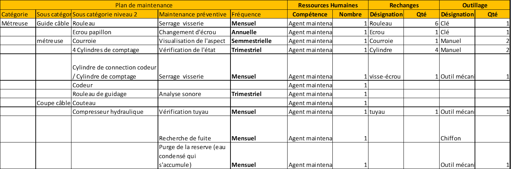

**AMDEC**

| Catégorie | Sous catégorie nivea | Sous catégorie niveau 2 | Mode de défaillance | Cause de défaillance | Effet | Moyen de détection | Action en réduction de risque |
|---|---|---|---|---|---|---|---|
| Métreuse | Guide câble | Rouleau | Desserage visserie | Usure | Perte de maitrise du cable | Mouvement du cable | Contrôle des rouleaux et serrer les écrous |
| Métreuse | Guide câble | Ecrou papillon | Endommagement physique | Usure | Désalignement du cable | Mouvement du cable | Contrôle des rouleaux et serrer les écrous |
| Métreuse | métreuse | Courroie | Fissure et désalignement | usure | Perte de transmission | Longeure calculée fausse | Echange de cylindre ou de courroie |
| Métreuse | métreuse | 4 Cylindres de comptage | Mauvais ajustement | frottement excessif | Perte de comptage | Longeure calculée fausse | Echange de cylindre ou de courroie |
| Métreuse | métreuse | Cylindre de connection codeur / Cylindre de comptage |  |  |  | Longeure calculée fausse | Echange de cylindre ou de courroie |
| Métreuse | métreuse | Codeur |  |  |  | Longeure calculée fausse | Echange de cylindre ou de courroie |
| Métreuse | métreuse | Rouleau de guidage | Mauvais ajustement | Mauvais positionnement | Cassure/rupture | Longeure calculée fausse | Echange de cylindre ou de courroie |
| Métreuse | Coupe câble | Couteau | Cassure | Accident | Cassure/rupture | Extremité du cable | Remplacer le couteau |
| Métreuse | Coupe câble | Compresseur hydraulique | Fuite d'eau | Pression | Perte de performance | Apparition d'une fuite | Réparer la fuite |
| Métreuse | Coupe câble |  |  |  |  | Apparition d'une fuite | Réparer la fuite |
| Métreuse | Coupe câble |  |  |  |  | Apparition d'une fuite | Réparer la fuite |

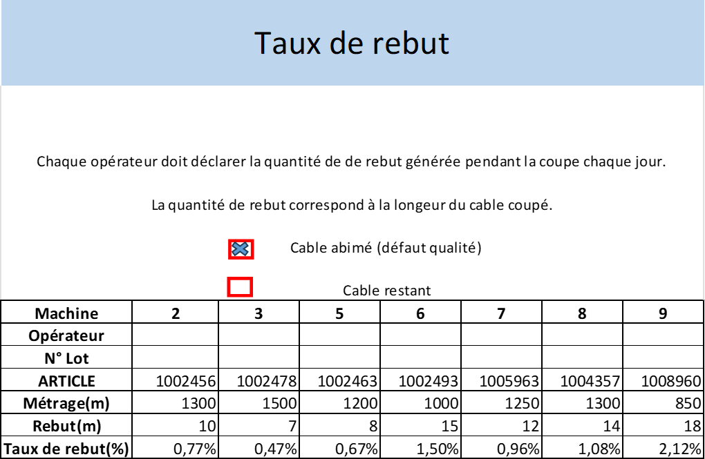
