# Amélioration du TRS d'une ligne de conditionnement de pain de sucre

> **Démarche :** Lean Six Sigma – DMAIC
> **Outils :** Excel, CATIA, QQOQCP, Pareto, AMDEC, Ishikawa (5M), 5 Pourquoi, 5S
> **Secteur :** agroalimentaire (sucrerie)
> **Confidentialité :** le nom de l'entreprise et du site ont été volontairement masqués.

## Sommaire

1. [Contexte et enjeux](#1-contexte-et-enjeux)
2. [Le procédé : de la betterave au pain de sucre](#2-le-procédé--de-la-betterave-au-pain-de-sucre)
3. [Définir](#3-définir)
4. [Mesurer](#4-mesurer)
5. [Analyser](#5-analyser)
6. [Améliorer et contrôler](#6-améliorer-et-contrôler)
7. [Résultats](#7-résultats)
8. [Conclusion](#8-conclusion)
9. [Annexes](#9-annexes)

---

## 1. Contexte et enjeux

Dans un contexte concurrentiel de plus en plus marqué, l'amélioration de la productivité est primordiale pour les industries agroalimentaires. Les entreprises adoptent des méthodes d'amélioration continue performantes, dont le **Lean Six Sigma** : il combine le Lean (élimination des gaspillages) et le Six Sigma (fiabilisation des processus) pour accélérer et sécuriser les processus, et répondre aux exigences du client.

Le groupe industriel où j'ai réalisé ce projet a lancé une démarche **Lean Manufacturing** pour optimiser ses procédés de production, en commençant par la fabrication du pain de sucre. Le projet « Amélioration du Taux de Rendement Synthétique (TRS) » s'inscrit dans cette démarche. Il est prévu pour être déployé zone après zone ; la **zone de conditionnement** a été traitée en premier, à la demande de la direction de la production.

**Impact économique :** chaque point de TRS gagné réduit le coût de production de **3 Dhs par tonne**, soit un gain d'environ **150 000 Dhs par an**.

**Démarche :** DMAIC (Définir, Mesurer, Analyser, Implémenter, Contrôler), avec les outils suivants : QQOQCP, 5S, Ishikawa (5M), analyse de Pareto et 5 Pourquoi.

---

## 2. Le procédé : de la betterave au pain de sucre

### 2.1 Fabrication du sucre blanc

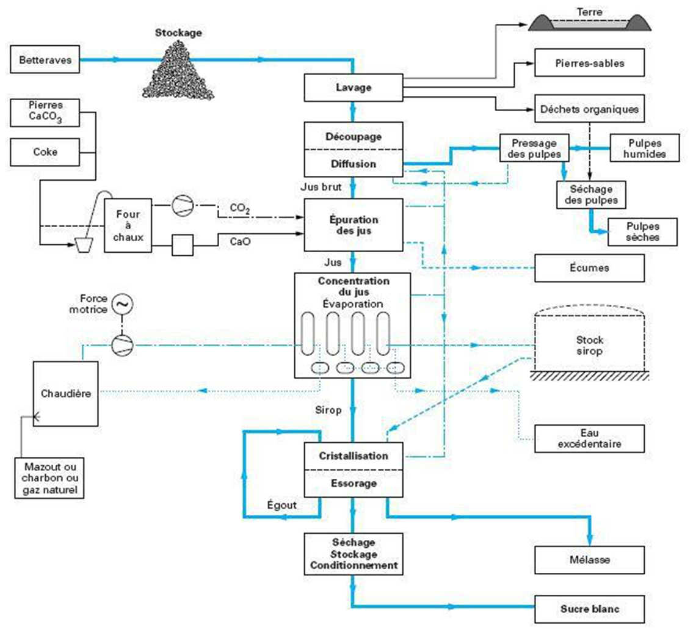

1. **Réception et stockage :** les betteraves sont pesées, analysées, puis stockées ou envoyées directement au lavage.
2. **Lavage :** transportées par voie hydraulique ou à sec, elles sont débarrassées de la terre, des feuilles et des pierres.
3. **Découpage et diffusion :** les betteraves sont coupées en fines lamelles (les *cossettes*). Dans le diffuseur, de l'eau circulant à contre-courant extrait le sucre et devient du *jus*. Les cossettes épuisées deviennent des *pulpes*.
4. **Pressage et séchage des pulpes :** les pulpes contiennent 92 à 93 % d'eau ; elles passent en presse pour être séchées.
5. **Épuration des jus :** le jus brut contient de l'eau, du sucre et des « non-sucres ». La chaux et le gaz carbonique en éliminent le maximum.
6. **Évaporation :** le jus (environ 84,5 % d'eau) est concentré jusqu'à environ 30 % d'eau pour obtenir le sirop (« jus dense »).
7. **Cristallisation :** le sirop est concentré sous vide partiel et ensemencé de cristaux. La « masse cuite » obtenue passe en centrifugeuse : on récupère le sucre blanc, encore légèrement humide (0,5 à 1,5 %), qu'il faut sécher.

### 2.2 Fabrication du pain de sucre (périmètre du projet)

Le sucre blanc est séché à l'air chaud dans des cylindres rotatifs, puis refroidi pour atteindre 0,03 à 0,06 % d'humidité. Il est ensuite tamisé, classé et pesé.

L'**atelier de conditionnement** est la seule zone de l'usine qui fonctionne toute l'année, 24 h/24. Il assure le conditionnement en sachets de 2 kg, en sacs de 50 kg, et la production du pain de sucre à partir de sucre granulé. Ce sucre est produit pendant la campagne betteravière et stocké dans de grands silos pour alimenter la production pendant l'inter-campagne.

L'atelier compte **deux lignes de production** de pain de sucre. Chacune comprend : une mouleuse, deux fours à micro-ondes, un refroidisseur, un axe à grappins, une brosse, un répartiteur et une habilleuse. Deux ateliers support complètent le dispositif : la maintenance et la qualité.

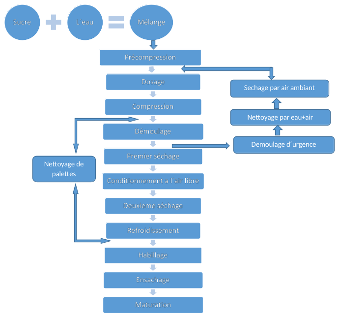

**Les étapes :**

| Étape | Description |
|---|---|
| **Approvisionnement** | Des camions-citernes alimentent en continu les silos de stockage en sucre granulé. |
| **Fabrication (mouleuse)** | Les convoyeurs alimentent les trémies de 15 t. La mouleuse moule et démoule **8 pains à la fois** (voir détail ci-dessous). Une palette pleine contient 80 pains. |
| **Séchage** | Deux fours à micro-ondes en série : le premier préchauffe (100 à 130 s, sortie à 60–70 °C), le second termine le séchage (température de sortie cible : 90 °C). Les magnétrons génèrent les ondes, absorbées par les molécules d'eau. |
| **Refroidissement** | Refroidissement à l'air ambiant sur chaîne, puis tunnel de ventilateurs pour solidifier complètement le pain. |
| **Conditionnement** | L'axe à grappins transfère 8 pains à la fois sur la bande d'alimentation de l'habilleuse, qui les enroule dans un papier d'emballage, le colle et le plie. Les pains conformes sont regroupés par 8, mis en cartons, puis palettisés. |

**Détail du moulage :**

- nettoyage des moules (eau sous 3 à 5 bars et air comprimé) ;
- préparation de l'eau (pH d'environ 10) ;
- malaxage eau + sucre granulé (humidité finale spécifiée : 1,8 à 2 %) ;
- pré-compression (140 à 150 bars, par quatre vérins) ;
- dosage (2 000 g ± 20 g par moule, un pain pèse 2 kg) ;
- compression (deux vérins de compression, quatre de contre-pression) ;
- démoulage à l'air comprimé (3 à 6 bars).

**Problèmes de séchage rencontrés :** humidité supérieure à la consigne (1,8 à 2 %), magnétrons hors service, excès de sucre granulé qui absorbe l'énergie des ondes.

---

## 3. Définir

### 3.1 Problématique

Le pain de sucre est un produit important sur le marché local et la demande augmente chaque année. La sucrerie produit **180 tonnes de pain de sucre par jour**. Ce procédé est l'un des plus difficiles à paramétrer et à optimiser : il exige des machines complexes, difficiles à maintenir, et une main-d'œuvre qualifiée. Le **rebut représente environ 2 %** de la production des deux lignes.

J'ai choisi le **TRS** (Taux de Rendement Synthétique) comme indicateur de performance de référence, et l'outil **QQOQCP** pour structurer la problématique :

| Question | Réponse |
|---|---|
| **Quoi ?** Quel est le problème ? | TRS faible sur la ligne de conditionnement ; taux de rebut de pain de sucre élevé. |
| **Qui ?** Qui est concerné ? | Le département conditionnement : production, qualité et maintenance. |
| **Où ?** Périmètre | La ligne de conditionnement, au niveau de deux machines : la mouleuse et l'habilleuse. |
| **Quand ?** Depuis quand ? | Depuis la mise en route des machines. |
| **Comment ?** Comment mesurer ? | Par les gaspillages dans le flux de production et le taux de rebut. |
| **Pourquoi ?** Pourquoi le résoudre ? | Améliorer la disponibilité des machines, améliorer la productivité, diminuer le taux de rebut. |
| **Données de sortie** | TRS élevé et gaspillages éliminés ; chantier 5S et plan de maintenance. |

### 3.2 Objectifs

Améliorer le TRS des machines de production du pain de sucre et mettre en place des solutions efficaces pour les différents problèmes des lignes de conditionnement.

---

## 4. Mesurer

La phase « Mesurer » consiste à collecter les données nécessaires pour comprendre les causes de dégradation du TRS. Elle repose uniquement sur des données réelles.

### 4.1 Le TRS

Le TRS est un indicateur de performance d'un équipement : il mesure l'utilisation effective d'un moyen de production et met en évidence sa marge de progrès en productivité et en qualité.

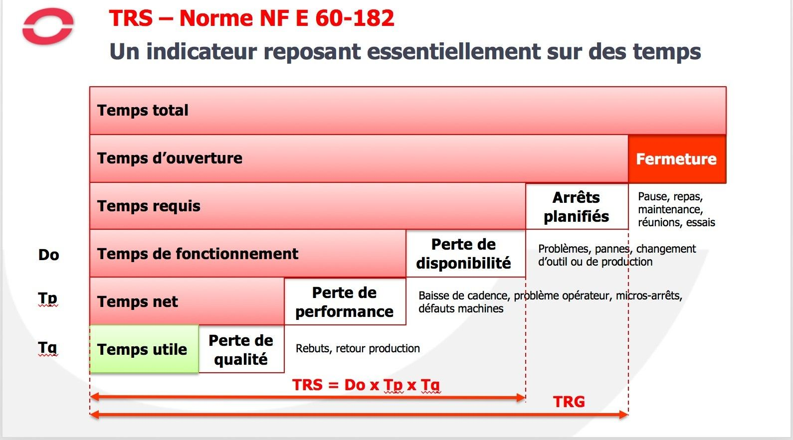

J'ai retenu la méthode de **multiplication des ratios**, qui permet d'identifier les pertes majeures. Pour faire progresser le TRS, il faut agir sur le « non-TRS » : **rebuts, micro-arrêts, pannes et pertes de vitesse**.

**TRS = TD × TP × TQ = Temps utile / Temps d'ouverture**

| Indicateur | Formule |
|---|---|
| **TD** – Taux de disponibilité | (Temps requis − Temps d'arrêt) / Temps requis |
| **TP** – Taux de performance | (TCT × QP) / TBF |
| **TQ** – Taux de qualité | (Quantité produite − Quantité rebutée) / Quantité produite |

- *Temps requis* = temps d'ouverture − temps où le système n'est pas sollicité (préparation, pauses).
- *Temps d'arrêt* = arrêts pour pannes + arrêts pour réglages.
- *QP* = quantité produite ; *TBF* = temps brut de fonctionnement ; *TCT* = temps de cycle théorique.

**Objectifs de référence :**

| Indicateur | Objectif |
|---|---|
| Vitesse de fabrication | 0,13 tonne/minute |
| Taux de disponibilité | 90 % |
| Taux de performance | 95 % |
| Taux de qualité | 99,9 % |
| **TRS** | **85 %** |

### 4.2 Suivi du TRS initial

L'atelier fonctionne 24 h/24 avec trois équipes en trois postes sur deux lignes : poste 1 (6 h – 14 h), poste 2 (14 h – 22 h), poste 3 (22 h – 6 h).

J'ai calculé le TRS initial à partir de l'historique des arrêts du mois de mai 2020 (voir [Annexe 1](#annexe-1--historique-des-arrêts-mai-2020)). Paramètre constant pour les trois postes : la capacité des deux mouleuses, soit 34 t toutes les 8 h (0,07 t/minute). Après saisie dans Excel :

| Poste | Disponibilité (%) | Performance (%) | Qualité (%) | **TRS (%)** |
|---|---|---|---|---|
| Poste 1 | 85 | 83 | 98 | **69,14** |
| Poste 2 | 83 | 84 | 98 | **68,33** |
| Poste 3 | 83 | 85 | 98 | **69,14** |

**Interprétation :**

- le TRS moyen est faible (**≈ 68,9 %**) ; l'objectif fixé par la sucrerie est de **75 %** ;
- la disponibilité moyenne est de **83,7 %** : il y a des pannes et des arrêts ;
- la performance moyenne est de **84 %** : il y a des ralentissements ;
- la qualité moyenne est de **98 %** : il y a des rebuts.

### 4.3 Taux de rebut

**TR = (nombre de rebuts / nombre total de produits) × 100**

| Ligne | Production (t) | Rebut (t) | TR (%) |
|---|---|---|---|
| Ligne 2 | 63,36 | 1,20 | **1,89** |
| Ligne 3 | 57,60 | 1,17 | **2,03** |

Le rebut représente près de **2 %** de la production, avec un taux plus élevé sur la ligne 3.

J'ai suivi ces paramètres pendant 21 jours. Les trois composantes du TRS (disponibilité, performance, qualité) font chacune l'objet d'actions dans la suite du projet.

---

## 5. Analyser

### 5.1 Analyse de Pareto des micro-arrêts

J'ai classé les équipements en sous-groupes (fours à micro-ondes, mouleuse, élément de transfert, habilleuse, répartiteur), calculé le total des arrêts de chacun, puis tracé le diagramme de Pareto pour identifier les sous-groupes critiques.

| Ensemble | Sous-ensemble | Mode de détérioration | Fréquence | Durée (min) | Cumul | % cumulé |
|---|---|---|---|---|---|---|
| Fours à micro-ondes | Four | Présence de sucre caramélisé | 31 | 900 | 900 | 51 % |
| Mouleuse | Grappins | Blocage de la bande métallique | 4 | 90 | 990 | 56 % |
| Mouleuse | Dépôt | Défaut du détecteur de collision palette | 3 | 70 | 1 060 | 60 % |
| Langhammer | Élément de transfert | Rupture de la chaîne de transport | 2 | 70 | 1 130 | 64 % |
| Gronomeyer | Répartiteur | Blocage des moteurs | 2 | 70 | 1 200 | 68 % |
| Langhammer | Élément de transfert | Usure des téflons de guidage | 1 | 60 | 1 260 | 71 % |
| Habilleuse | Entrée/sortie | Blocage des vérins pneumatiques | 1 | 60 | 1 320 | 74 % |
| Mouleuse | Station hydraulique | Mise en marche du ventilateur de refroidissement | 1 | 60 | 1 380 | 78 % |
| Fours à micro-ondes | Générateurs | Défaut de fonctionnement des magnétrons | 2 | 50 | 1 430 | 81 % |
| Mouleuse | Système de dosage | Dépôt de sucre | 2 | 50 | 1 480 | 83 % |
| Fours à micro-ondes | Générateurs | Court-circuit des générateurs | 1 | 40 | 1 520 | 86 % |
| Habilleuse | Revolver | Usure des galets d'ouverture des mâchoires | 1 | 40 | 1 560 | 88 % |
| Langhammer | Rouleaux | Blocage du moteur des rouleaux | 1 | 40 | 1 600 | 90 % |
| Langhammer | Élément de transfert | Dysfonctionnement des détecteurs de position | 2 | 35 | 1 635 | 92 % |
| Mouleuse | Pré-compression | Détecteur mal positionné ou hors service | 1 | 30 | 1 665 | 94 % |
| Habilleuse | Revolver | Dérèglement des mâchoires | 1 | 30 | 1 695 | 95 % |
| Langhammer | Rouleaux | Usure des rouleaux | 1 | 30 | 1 725 | 97 % |
| Mouleuse | Translation linéaire | Dysfonctionnement des vérins pneumatiques | 1 | 30 | 1 755 | 99 % |
| Mouleuse | Grappins | Blocage des doigts | 1 | 20 | 1 775 | 100 % |

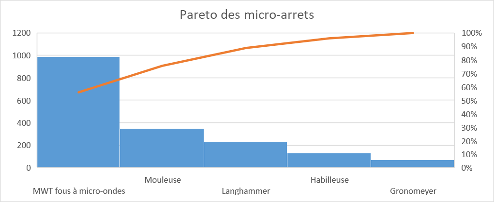

**Constats :**

- les **fours à micro-ondes** génèrent plus de la moitié des micro-arrêts (56 % du temps cumulé) ;
- le sucre caramélisé empêche les portes des fours de se fermer : la cadence ralentit et la cuisson des pains est perturbée, d'où du pain rebuté ;
- **l'habilleuse** et **la mouleuse** connaissent aussi des arrêts importants, à cause de l'usure des composants et de la présence de sucre sur les machines.

### 5.2 AMDEC de l'habilleuse

L'**AMDEC** (Analyse des Modes de Défaillance, de leurs Effets et de leur Criticité) est une méthode prédictive : on imagine les dysfonctionnements avant qu'ils ne se produisent, pour identifier leurs causes et leurs effets, puis les actions qui permettent de les éliminer ou de les réduire.

**Analyse fonctionnelle.** Avec les équipes de terrain, j'ai détaillé le fonctionnement de la machine en partant de la fonction principale pour la décomposer en fonctions plus fines.

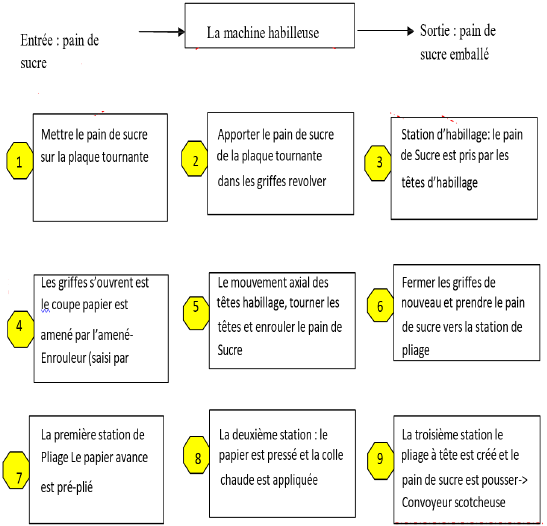

**Découpage fonctionnel et matériel.** J'ai défini quatre sous-systèmes : **entrée-sortie**, **habillage**, **papier** et **injection de la colle chaude**.

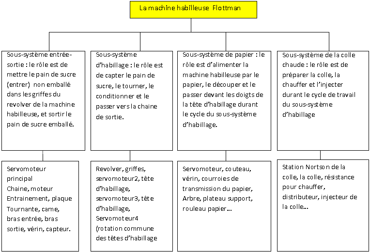

**Évaluation de la criticité.** Trois critères sont notés de 1 à 4 :

| Note | Gravité – arrêt de la machine (G) | Fréquence de la défaillance (F) | Non-détection (N) |
|---|---|---|---|
| 1 | Inférieur à 30 min | Moins d'une fois par an | Détection efficace permettant une action préventive |
| 2 | Entre 30 et 40 min | Moins d'une fois par mois | Risque de non-détection dans certains cas |
| 3 | Entre 40 min et 1 h | Moins d'une fois par semaine | Système de détection peu fiable |
| 4 | Supérieur à 1 h | Plus d'une fois par semaine | Aucune détection |

**Criticité : C = G × F × N.** Les équipes de terrain ont fixé le seuil à **8** :

- **C ≤ 8** : arrêt acceptable, la maintenance corrective suffit ;
- **C > 8** : niveau inacceptable, une maintenance préventive est nécessaire.

Grille de synthèse AMDEC de l'habilleuse, remplie avec les équipes :

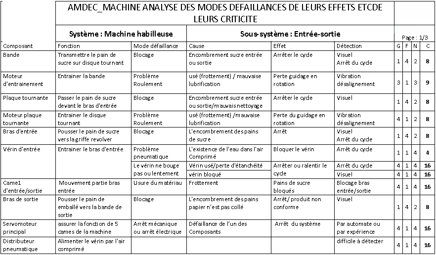

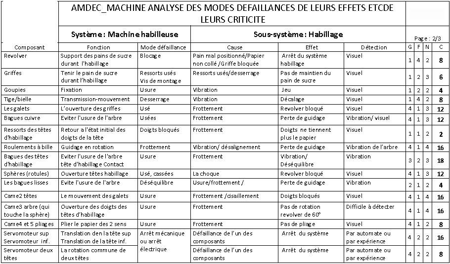

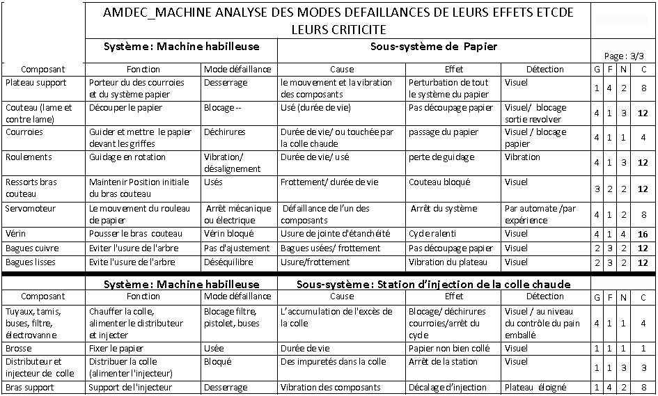

### 5.3 Analyse du rebut

Le rebut représente actuellement entre 1,2 % et 2 % de la production de l'atelier. Il engendre des pertes : coût de production des pains non conformes et coût de recyclage (stockage, broyage, transport, raffinage).

Quantités de rebut relevées en quatre points de chaque ligne :

| Point de mesure | Ligne 2 | Ligne 3 |
|---|---|---|
| Habilleuse (kg) | 85,55 | 121,83 |
| Axe à grappins (kg) | 274,33 | 277,83 |
| Mouleuse (kg) | 166,50 | 136,33 |
| Brosse (kg) | 143,50 | 126,50 |

Pour identifier les causes, j'ai mené une recherche sur le terrain, puis construit un **diagramme d'Ishikawa (5M)**.

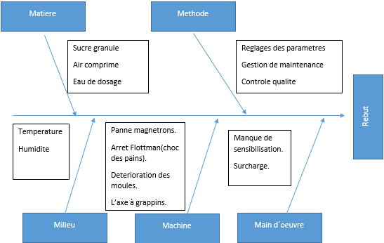

J'ai ensuite suivi les quantités de rebut pendant **20 jours**, chaque jour à 13 h 40 (avant la fin de l'équipe de 6 h – 14 h), en quatre points : la mouleuse, l'axe à grappins, la brosse et l'habilleuse. J'ai calculé les moyennes par point.

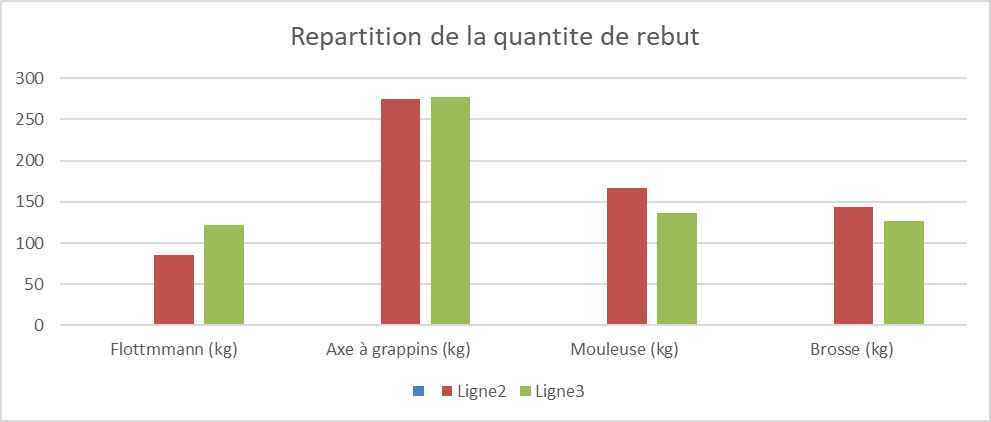

- l'habilleuse de la ligne 3 génère plus de rebut que celle de la ligne 2, ce qui s'explique par son plus grand nombre d'arrêts ;
- pour la mouleuse et la brosse, l'écart entre les deux lignes est faible ;
- **l'axe à grappins génère la plus grande quantité de rebut.**

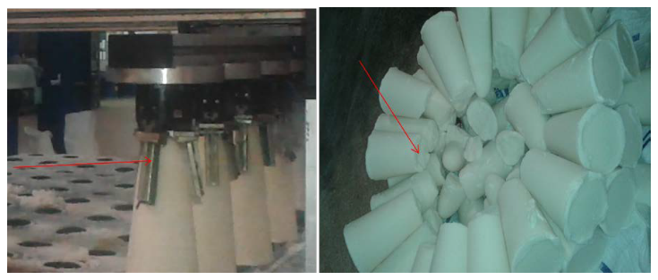

### 5.4 Causes racines : méthode des 5 Pourquoi

**Problème : le rebut.**

- **Non-maturation du pain de sucre**
  - Mauvais séchage au niveau du four
    - Panne des magnétrons → manque de signalisation en cas de panne
    - Perte d'énergie de séchage → échange thermique avec le milieu → **blocage des portes du four** *(cause racine)*
    - Mauvais réglage des paramètres du système de commande → système de dosage d'eau non fiable → écart entre la valeur réelle et la valeur affichée
- **Détérioration de la tête du pain**
  - Pain non mature
  - Le pain ne supporte pas la force appliquée → **l'axe à grappins saisit le pain par la tête, partie fragile** *(cause racine)*
  - Pain déplacé manuellement → arrêt de l'habilleuse
- **Déformation au moulage**
  - Défauts de moulage → nettoyage des moules → **pression d'eau insuffisante** *(cause racine)*
  - Fissures → vibration des palettes pendant le transport → **rouleaux de déplacement usés** *(cause racine)*

---

## 6. Améliorer et contrôler

Chaque composante du TRS fait l'objet d'actions dédiées : disponibilité (maintenance préventive), qualité (réduction du rebut) et performance (5S et formation).

### 6.1 Améliorer la disponibilité : plan de maintenance préventive

Pour réduire la criticité des modes de défaillance, il faut réduire la fréquence, la gravité et la non-détectabilité. Quatre types d'interventions préventives sont utilisés :

- **Inspection :** réglages simples, sans arrêt de la production ni préparation d'outils. Utile pour les arrêts de criticité acceptable.
- **Contrôle :** vérification de conformité par rapport à des données préétablies, pour décider d'un échange, d'une action corrective ou d'un arrêt planifié. Réduit la non-détectabilité.
- **Visite ou révision :** examen planifié de toutes les parties d'un système (arrêt général). Réduit la gravité et la fréquence.
- **Échange standard :** remplacement d'un composant usé ou défectueux. Réduit la fréquence des arrêts liés à l'usure.

À partir de la grille AMDEC, j'ai défini, pour chaque mode de défaillance, l'action préventive, sa fréquence et son responsable. **Le plan a été validé par le responsable de l'atelier de conditionnement et appliqué par les équipes.**

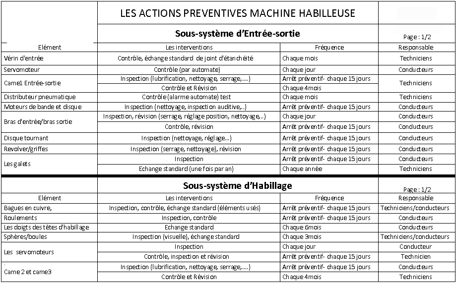

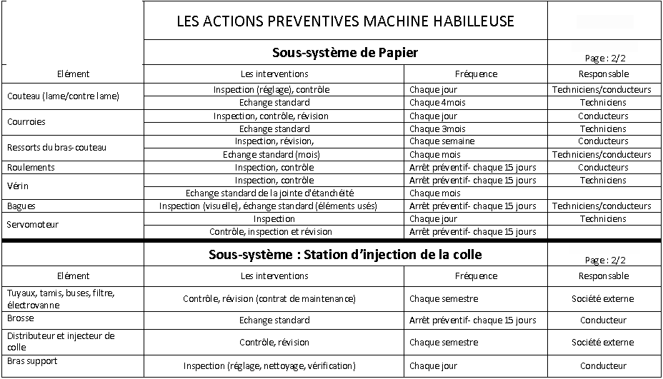

J'ai aussi proposé des actions d'amélioration pour réduire la criticité :

- automatiser davantage la détection des défaillances (c'est la non-détection qui génère la criticité la plus forte) ;
- remplacer les distributeurs par des modèles plus fiables, avec signal de détection de panne ;
- utiliser le système de nettoyage prévu par le constructeur, pour éviter l'usure causée par les grains de sucre ;
- utiliser les lubrifiants prévus par le constructeur ;
- installer près du conducteur une table d'outils avec pièces de rechange et consommables pour les inspections quotidiennes ;
- remplir après chaque intervention une fiche de suivi des interventions préventives par composant (voir [Annexe 2](#annexe-2--fiche-de-suivi)).

### 6.2 Améliorer la qualité : réduire le rebut

| Cause racine | Action |
|---|---|
| Nettoyage des moules | Augmenter la pression de l'eau et la fréquence de nettoyage |
| Doseur d'eau | Installer un détecteur d'humidité du mélange avant la pré-compression |
| Rouleaux de déplacement | Contrôle continu |
| Absence de plan de contrôle | Établir un plan de contrôle qualité / process |
| Température de l'eau de mélange | Étudier l'usage d'eau chaude à l'entrée du mélangeur |
| Température de l'air de séchage | Étudier l'usage d'air préchauffé à l'entrée du four |
| Fours à micro-ondes | Voir solution 1 |
| Axe à grappins | Voir solution 2 |

#### Solution 1 : tunnel isolant entre les fours

Le problème des fours est la non-maturation du pain, causée par une mauvaise cuisson, qui génère du rebut en aval. J'ai proposé de réaliser un **tunnel isolant reliant les deux fours successifs**, de la porte arrière du premier à la porte avant du second. Il garantit une bonne cuisson, évite la perte d'énergie et la présence de sucre caramélisé au niveau des portes.

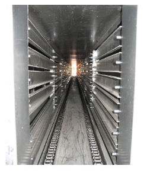

#### Solution 2 : nouvelle conception de l'axe à grappins

L'axe actuel maintient le pain par la partie la plus fragile (la tête), ce qui le casse facilement. Ce choix de conception a été fait pour des raisons économiques : le pain complète sa maturation après environ 2 jours de stockage.

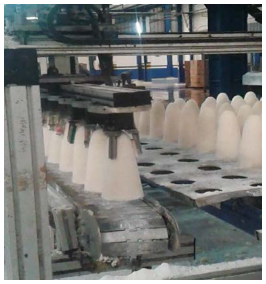

J'ai proposé **deux axes parallèles** qui maintiennent toute une rangée de 8 pains en appliquant la même pression en sens opposés, **au niveau de la base** (la partie la plus solide et la plus dense). Des bandes de caoutchouc évitent les cassures. La solution a été modélisée avec **CATIA** :

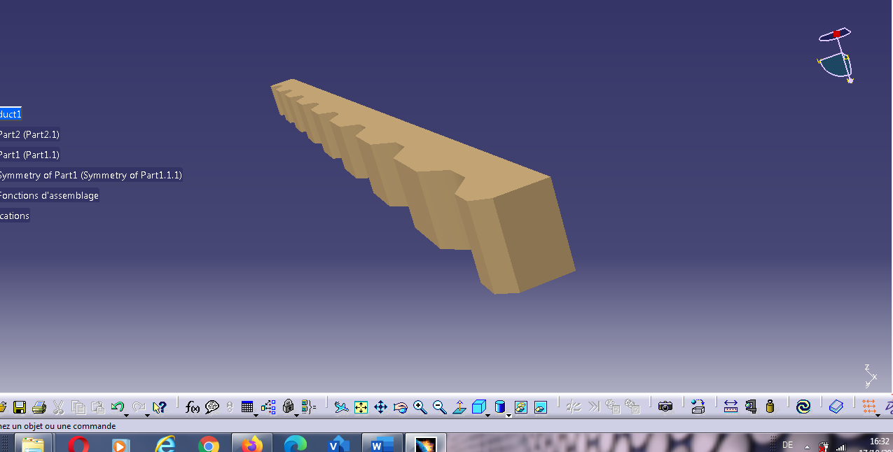

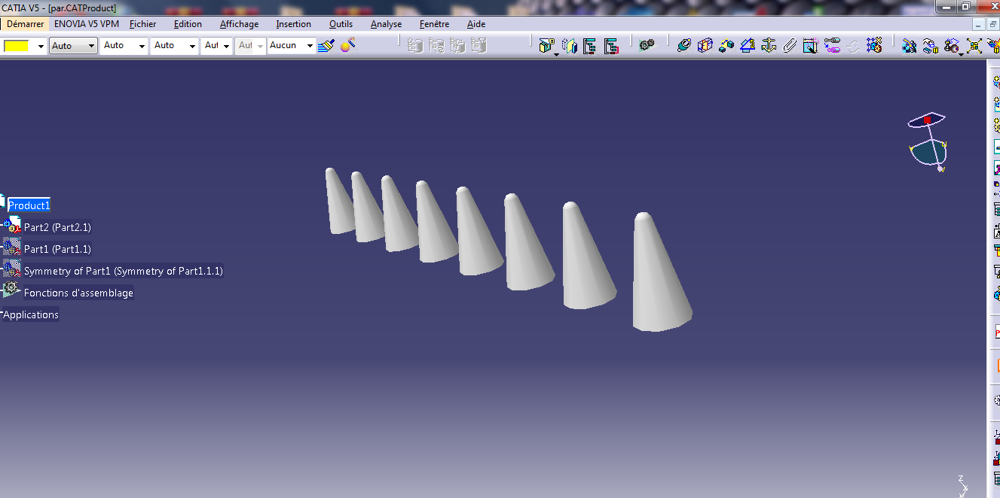

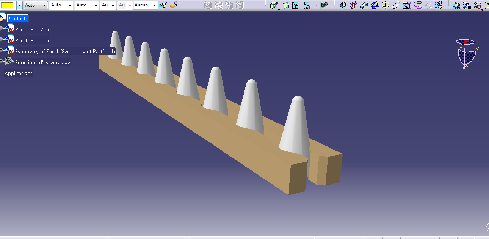

### 6.3 Améliorer la performance : chantier 5S et formation

Les 5S sont une approche systématique pour améliorer la propreté et l'ordre de l'environnement de travail. L'atelier est divisé en six zones : espace commun, conditionnement 2 kg, ensacheuse 50 kg, station hydraulique, mouleuse et habilleuse.

Après plusieurs inspections sur le terrain, trois zones nécessitaient un travail :

- **zone habilleuse :** deux machines très souvent à l'arrêt, donc zone mal rangée et mal nettoyée ;
- **zone mouleuse** (mouleuse, brosse, fours) : chutes de sucre granulé au sol, aggravées par l'eau utilisée pour nettoyer les moules ;
- **espace commun :** absence de tableau d'affichage, stocks de papier dispersés, affaires personnelles des opérateurs, manque de nettoyage et de poubelles.

#### 1S – Trier

- classer le matériel selon sa fréquence d'utilisation (faible, moyenne, élevée) ;
- isoler ce qui est utile : palettes (rebuts), sachets vides (rebut avant broyage), sachets pleins (utilisés après broyage) ;
- se débarrasser des objets inutiles posés sur le broyeur et les machines ;
- évacuer une trémie de mélange de sirop inutilisée qui occupait de l'espace.

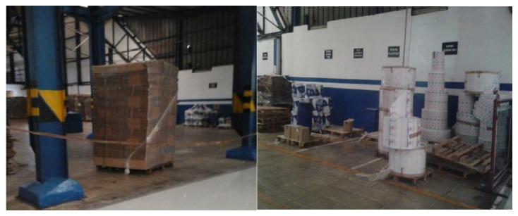

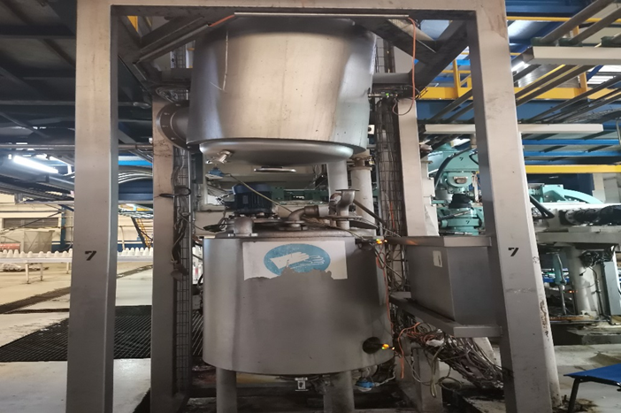

#### 2S – Ranger : « une place pour chaque chose et chaque chose à sa place »

- ranger les bobines de papier près de l'habilleuse, ainsi que les sachets de 2 et 50 kg de sucre granulé ;
- tracer au sol des lignes de séparation et des flèches directionnelles ;
- construire un vestiaire à trois postes pour les affaires du personnel.

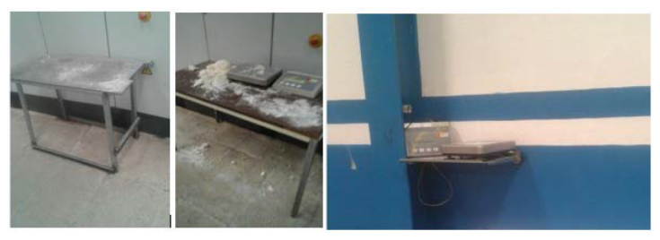

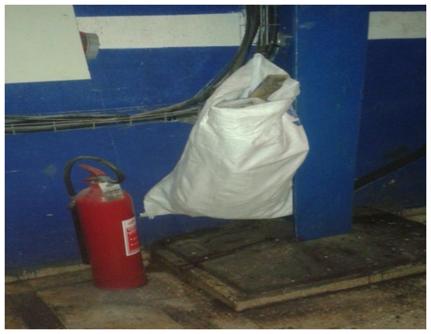

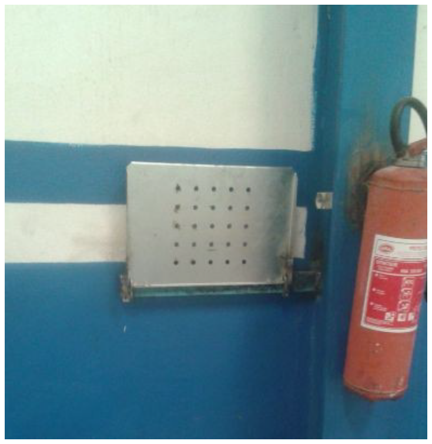

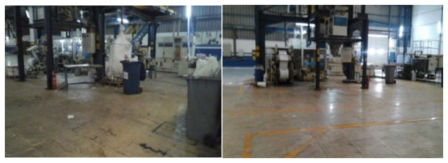

#### 3S – Nettoyer

- construire un sol adapté et régler le problème d'écoulement d'eau ;
- mettre en place une station de nettoyage avec les outils et produits nécessaires ;
- nettoyer la mouleuse et le four chaque jour, et le sol de tout l'atelier tous les trois jours.

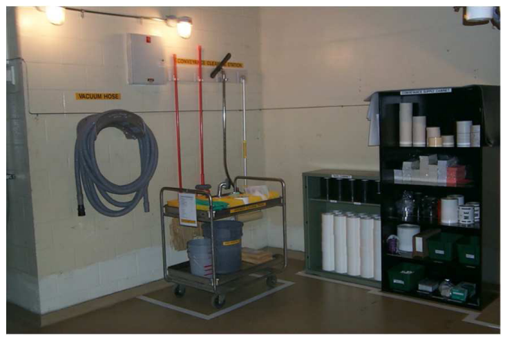

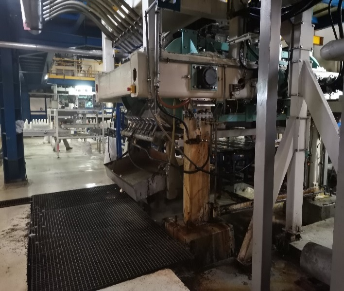

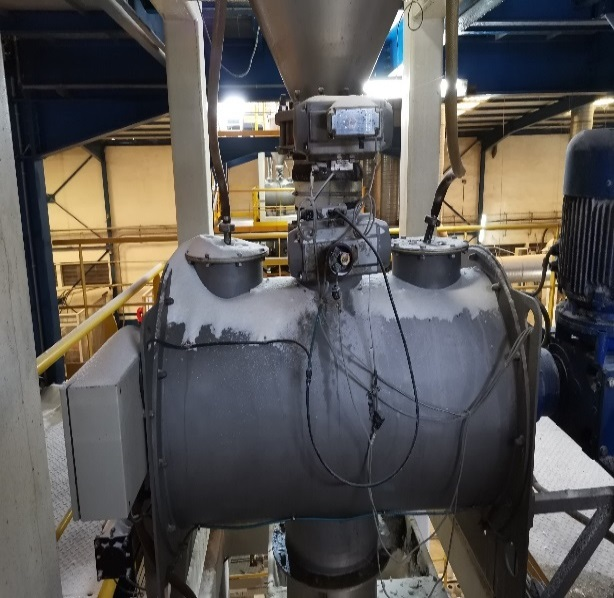

#### 4S et 5S – Standardiser et maintenir

**Standardiser :** rendre les tâches des trois premiers S standard et visibles de tous (management visuel). J'ai rédigé et affiché les standards de chaque zone (tâches, responsable, fréquence, outils), avec une fiche de suivi pour chacun (voir [Annexe 3](#annexe-3--standards-de-nettoyage-et-fiches-de-suivi-5s)).

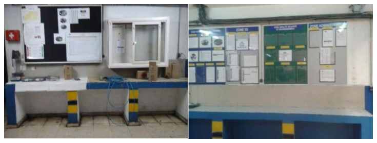

**Maintenir :** maintenir les quatre premiers S dans la durée est difficile. Il a été décidé de s'appuyer sur un contrôle quotidien, l'amélioration continue à partir des propositions du personnel, la formation et le soutien des équipes.

#### Formation du personnel

Les opérateurs et conducteurs de machine sont des journaliers qui manquent de formation de base. J'ai proposé :

- une formation des conducteurs de la mouleuse et de l'habilleuse, à la maintenance préventive et aux standards 5S ;
- de la réaliser **pendant les heures de travail**, animée par les techniciens de l'atelier lors des temps d'arrêt pour maintenance, pour éviter les pertes de production et les coûts d'investissement ;
- une réunion mensuelle du responsable de production et du responsable de maintenance pour évaluer le niveau de formation, présenter le suivi des tâches et les résultats, et discuter des propositions des opérateurs.

---

## 7. Résultats

Après la mise en place des actions, j'ai refait le suivi et le calcul du TRS :

| | Disponibilité | Performance | Qualité | **TRS** |
|---|---|---|---|---|
| **Avant** (moyenne des 3 postes) | 83,7 % | 84,0 % | 98 % | **≈ 68,9 %** |
| **Après** | 85,8 % | 87,4 % | 98 % | **73,5 %** |
| **Évolution** | +2,1 pts | +3,4 pts | = | **+4,6 pts** |

- le TRS s'améliore, de **68,9 % à 73,5 %**, et se rapproche de l'objectif du site (75 %) ;
- les gains portent sur la **disponibilité** (plan préventif) et la **performance** (5S, formation) ;
- cette amélioration ne peut pas être attribuée aux seules actions 5S : à la même période, la sucrerie a commencé l'extraction du sucre et des opérateurs de laboratoire ont assuré un suivi continu de la production et des paramètres de la mouleuse ;
- les étapes « Standardiser » et « Maintenir » du 5S sont validées mais nécessitent encore du travail ;
- le suivi des résultats fait désormais partie du quotidien des responsables de production et de maintenance.

---

## 8. Conclusion

Ce projet a contribué à la mise en place d'une démarche Lean Manufacturing dans l'atelier de conditionnement, à travers l'amélioration du TRS des lignes de pain de sucre :

- **Disponibilité :** l'habilleuse concentre plus de 40 % des arrêts de la ligne. L'AMDEC a permis de définir un plan de maintenance préventive, validé et appliqué par l'atelier.
- **Qualité :** les causes racines du rebut ont été identifiées et des contre-mesures proposées. Pour l'axe à grappins, une solution simple à mettre en œuvre a été conçue, par modification de la conception du matériel existant.
- **Performance :** un chantier 5S dans les zones critiques, accompagné d'une formation du personnel sur les standards.

Le projet a permis de dérouler chaque étape du DMAIC de façon rationnelle et méthodique, avec des outils dédiés. Il montre aussi la nécessité d'une équipe pluridisciplinaire réunissant opérateurs, techniciens, responsables et direction.

---

## 9. Annexes

### Annexe 1 : historique des arrêts (mai 2020)

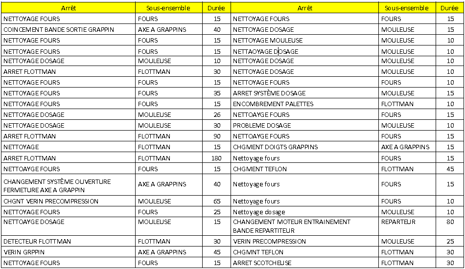

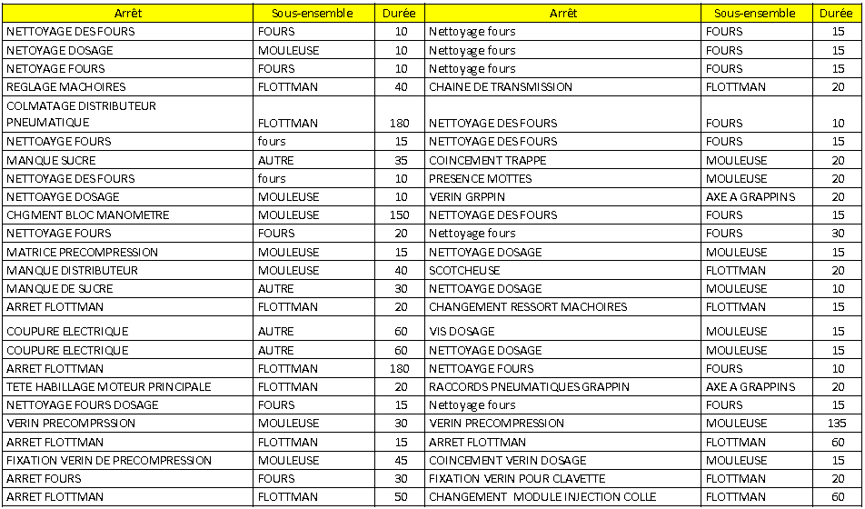

### Annexe 2 : fiche de suivi

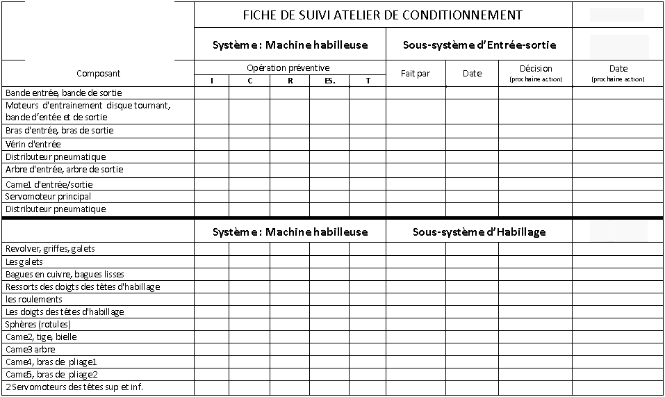

### Annexe 3 : standards de nettoyage et fiches de suivi 5S

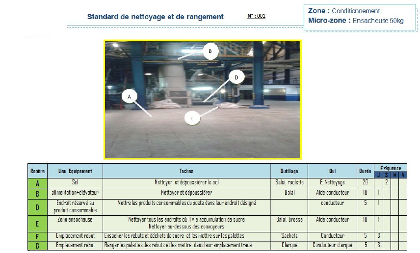

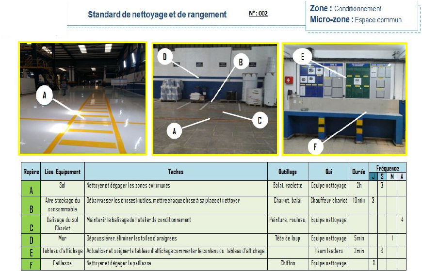

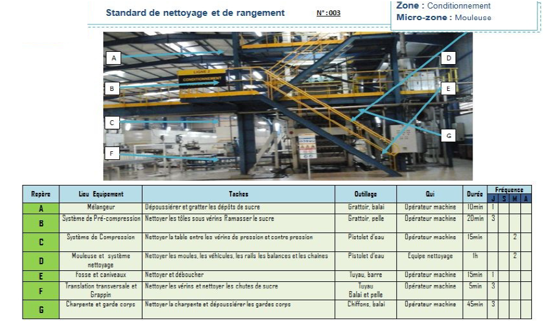

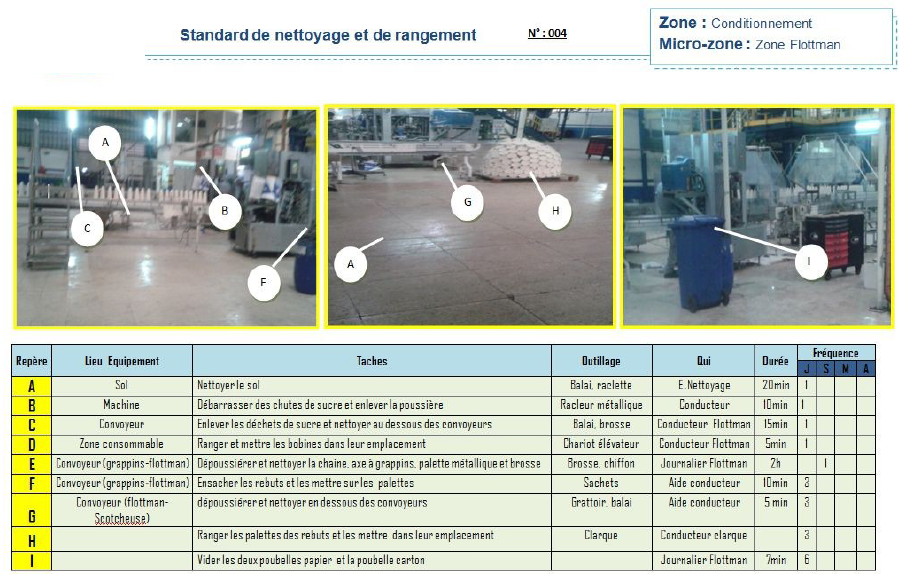

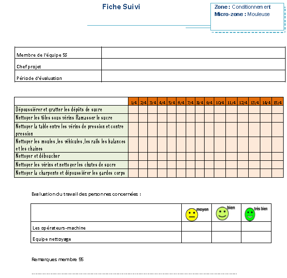

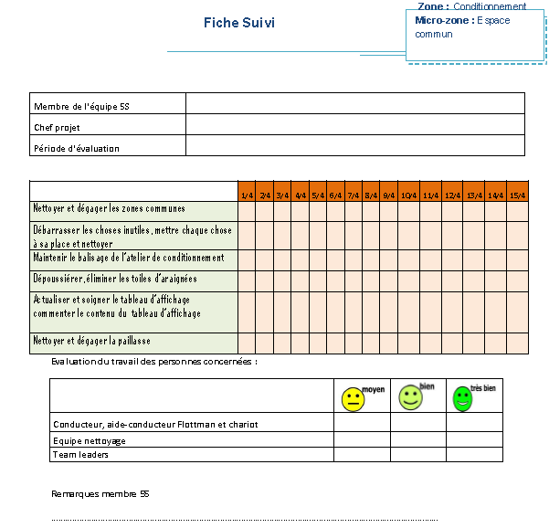

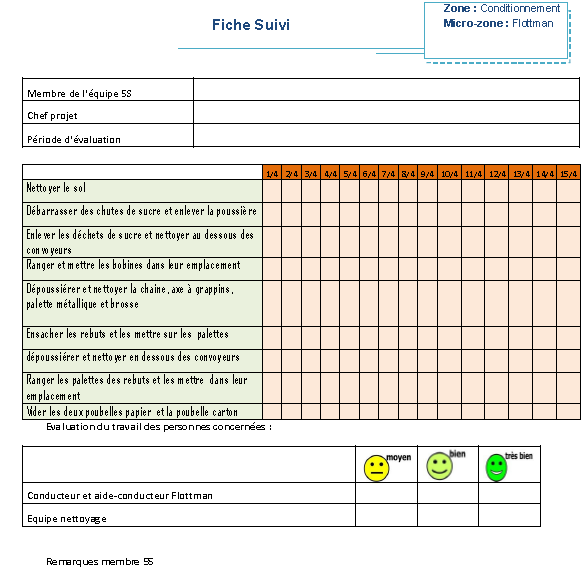
